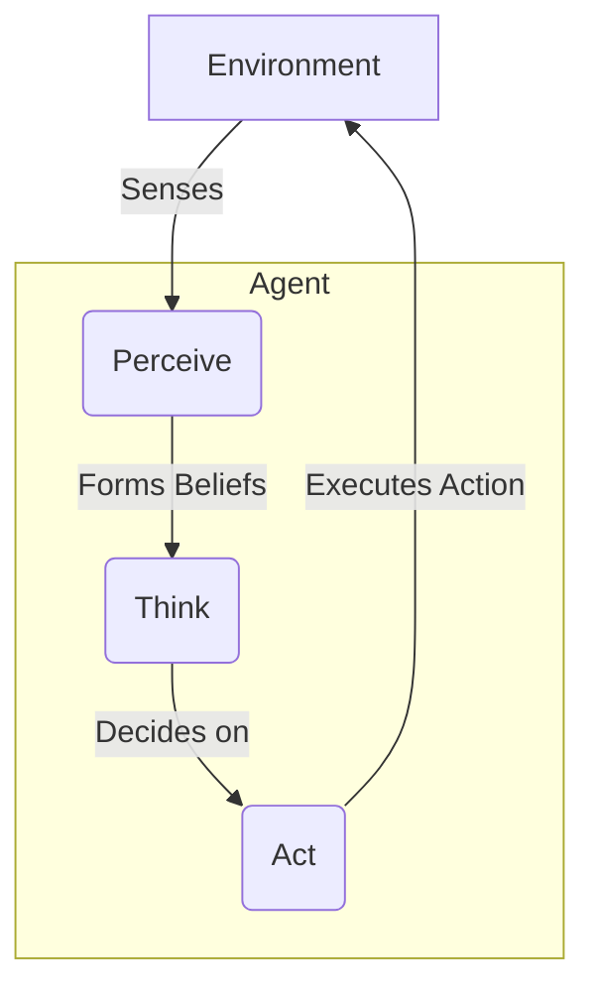

# Chapter 13: From Chatbots to Autonomous Agents

For decades, our interactions with computers have been defined by a simple loop: we make a request, and the machine gives a response. This model powers everything from command-line tools to sophisticated chatbots. But what if an AI could do more than just respond? What if it could perceive its environment, maintain its own goals, make plans, and take action—all without constant human intervention?

This is the leap from a simple tool to an **autonomous agent**. A chatbot is like a calculator: it answers the specific question you ask and then waits for the next one. An agent, by contrast, is like a financial advisor who actively monitors your portfolio, identifies opportunities based on market changes, rebalances your assets according to your long-term goals, and alerts you to critical risks.

In this chapter, we will deconstruct the magic behind AI agents. We will move beyond the request-response paradigm and architect systems that can think, plan, and act in the world.

### Learning Objectives

By the end of this chapter, you will be able to:

-   Clearly distinguish between a stateless chatbot and a goal-oriented agent.
-   Understand the core components that form an agent's "mind": perception, memory, reasoning, and action.
-   Architect a simple agent from scratch, building each component step-by-step.
-   Assemble these components into a functioning, autonomous IoT monitoring agent.
-   Decide when a fixed workflow is enough and when a task really needs an agent.

## The Limits of a Simple Chatbot

To appreciate what makes an agent special, let's first look at what it's not. Consider a standard chatbot powered by a Large Language Model (LLM).

```python
import openai

# Assumes the OPENAI_API_KEY environment variable is set
client = openai.OpenAI()
MODEL = "gpt-6-luna"

def simple_chatbot(user_input: str) -> str:
    """A basic, stateless chatbot function."""
    return client.responses.create(model=MODEL, input=user_input).output_text

# Each call to the function is a world of its own, with no memory of the past.
print(simple_chatbot("What is the current temperature of sensor T-001?"))
# Expected Response: "I'm sorry, but I don't have access to real-time data..."

print(simple_chatbot("Please check it again."))
# Expected Response: "I'm not sure what you mean by 'it'. Could you please clarify?"
```

This chatbot suffers from three fundamental limitations:

1.  **No Memory:** Every interaction is completely isolated. It cannot remember previous questions or its own answers. The second question, "Please check it again," is meaningless because the context of "it" is lost.
2.  **No Tools:** It cannot *do* anything. It can't query a database, read a sensor, or call an API. It's a closed system.
3.  **No Goals:** It is purely reactive. It has no long-term objectives it's trying to achieve. It simply waits for a prompt and responds.

An agent is designed to overcome these very limitations. It has memory, it can use tools, and it operates based on a set of goals.

### Workflows vs. Agents: Choose the Simplest Thing That Works

Before building an agent, it helps to use the distinction that has become standard in the industry:

-   A **workflow** is a system where *your code* defines the sequence of steps, and LLM calls fill in individual steps (the prompt chains of Chapter 10 are workflows).
-   An **agent** is a system where *the LLM decides* what to do next: which tool to call, with what arguments, and when the task is done, usually by calling tools in a loop.

Agents are more flexible, but also slower, more expensive, and harder to test, because their path is not known in advance. A good rule: if you can draw the steps as a flowchart, build a workflow. Reach for an agent when the steps genuinely depend on what is discovered along the way (open-ended troubleshooting, research, coding), and when errors can be caught and recovered from. This chapter builds a monitoring agent from first principles so you can see every moving part; Chapter 14 shows the tool-calling loop that modern agents are built on.

## The Agent Loop: A Blueprint for Autonomy

At its core, an intelligent agent operates on a continuous cycle. This is often called the **Perceive-Think-Act** loop. It's the fundamental pattern of behavior that allows an agent to interact with its environment in a meaningful and autonomous way.



1.  **Perceive:** The agent gathers information from its environment using a set of "sensors." This could be data from an IoT device, new messages in a chat, a stock price update, or the contents of a file.
2.  **Think:** The agent processes these perceptions. It updates its internal model of the world (its "beliefs"), reasons about the situation based on its goals, and decides on a course of action. This is the agent's "brain," often powered by an LLM.
3.  **Act:** The agent executes the chosen action, affecting the environment. This could involve sending an alert, writing to a database, restarting a server, or sending a message to a user.

This loop runs continuously, allowing the agent to adapt and respond to a changing world. Over the next sections, we will build Python classes that represent each stage of this loop.

## The Anatomy of an Agent

Let's construct our agent piece by piece, starting with its ability to sense the world.

### 1. Perception: The Agent's Senses

An agent's perception system is its window to the world. It's responsible for gathering raw data and structuring it into a format the agent can understand. We'll design a `PerceptionSystem` that can be configured with different "sensors"—functions that know how to read specific types of data from the environment.

First, let's define the class skeleton. It will hold a registry of sensor functions.

```python
from typing import Dict, Any, Callable, List

class PerceptionSystem:
    """Manages how an agent senses its environment."""
    def __init__(self):
        self.sensors: Dict[str, Callable] = {}

    def register_sensor(self, sensor_name: str, sensor_function: Callable):
        """Adds a new sensor to the agent's perception capabilities."""
        print(f"Sensor '{sensor_name}' registered.")
        self.sensors[sensor_name] = sensor_function
```

With `register_sensor`, we can give our agent new ways to perceive the world without modifying the core class. Now, let's define a sensor. A sensor is just a Python function that takes the state of the "environment" (represented as a dictionary) and extracts relevant information.

Here's a sensor for reading device temperatures.

```python
def temperature_sensor(environment: Dict[str, Any]) -> Dict[str, float]:
    """A sensor that extracts temperature readings from devices."""
    temps = {}
    for device_id, data in environment.get("devices", {}).items():
        if "temperature" in data:
            temps[device_id] = data["temperature"]
    return temps
```

Finally, we need the `perceive` method. This method orchestrates all registered sensors, runs them against the current environment data, and aggregates their findings into a single, structured perception.

```python
# Continuing the PerceptionSystem class...

    def perceive(self, environment: Dict[str, Any]) -> Dict[str, Any]:
        """Gathers data from all registered sensors."""
        all_perceptions = {}
        for name, func in self.sensors.items():
            try:
                # Run the sensor function and store its output
                all_perceptions[name] = func(environment)
            except Exception as e:
                all_perceptions[name] = {"error": str(e)}
        return all_perceptions
```

Let's see it in action. We'll create a perception system, register our sensor, and feed it some simulated environment data.

```python
import json

# 1. Create the system
perception_system = PerceptionSystem()

# 2. Register our sensor
perception_system.register_sensor("temperatures", temperature_sensor)

# 3. Define a simulated environment state
test_environment = {
    "devices": {
        "device_001": {"temperature": 75.2, "status": "online"},
        "device_002": {"temperature": 91.5, "status": "online"}, # High temp!
        "device_003": {"status": "offline"}, # No temperature data
    }
}

# 4. Run the perception cycle
current_perceptions = perception_system.perceive(test_environment)

print("\nAgent Perceptions:")
print(json.dumps(current_perceptions, indent=2))
```

**Output:**

```
Sensor 'temperatures' registered.

Agent Perceptions:
{
  "temperatures": {
    "device_001": 75.2,
    "device_002": 91.5
  }
}
```

Our agent can now "see" the temperatures of the devices. This structured data is the input for the next stage: thinking.

### 2. Memory: The Agent's Mind

A perception is fleeting. To make intelligent decisions, an agent must remember past perceptions, actions, and conclusions. A memory system provides this context.

A sophisticated memory system might have multiple layers (short-term, long-term, episodic), but let's start with the most critical one: a **short-term memory** that remembers recent events. We can use Python's `collections.deque` with a `maxlen` to create a memory that automatically discards the oldest items.

```python
from collections import deque
from datetime import datetime, timezone
from typing import Deque, Dict, Any, List

class MemorySystem:
    """Manages the agent's memory."""
    def __init__(self, short_term_capacity: int = 100):
        # A deque automatically discards old items when the max length is reached.
        self.short_term: Deque[Dict] = deque(maxlen=short_term_capacity)

    def store(self, memory_item: Dict[str, Any]):
        """Stores a copy of the item, stamped with the current time."""
        entry = {**memory_item, "timestamp": datetime.now(timezone.utc).isoformat()}
        self.short_term.append(entry)
        print(f"Stored in memory: {entry['type']}")

    def recall(self, query: str) -> List[Dict]:
        """Retrieves memories that match a simple text query."""
        # A very basic search; more advanced systems use vector search (Chapter 27).
        query_lower = query.lower()
        return [
            mem for mem in self.short_term
            if query_lower in json.dumps(mem, default=str).lower()
        ]
```

Storing a *copy* means later changes to the caller's dictionary can't silently rewrite the agent's past, and storing the timestamp as an ISO string keeps every memory JSON-serializable.

Let's test our memory system. We'll store the perceptions we gathered in the previous step and then try to recall information.

```python
# Create a memory system
memory = MemorySystem()

# Store our perception event
memory.store({
    "type": "perception",
    "data": current_perceptions
})

# Store another event, an action the agent took (hypothetically)
memory.store({
    "type": "action",
    "action_name": "log_status",
    "parameters": {"device_id": "device_001"}
})

# Now, let's recall information about device_002
recalled_memories = memory.recall("device_002")

print("\nRecalled Memories for 'device_002':")
print(json.dumps(recalled_memories, indent=2, default=str))
```

**Output:**

```
Stored in memory: perception
Stored in memory: action

Recalled Memories for 'device_002':
[
  {
    "type": "perception",
    "data": {
      "temperatures": {
        "device_001": 75.2,
        "device_002": 91.5
      }
    },
    "timestamp": "2026-10-18T09:30:00.123456+00:00"
  }
]
```

With memory, our agent now has context. It can connect the dots between past and present, which is essential for the reasoning process.

### 3. Reasoning: The Agent's Brain

The reasoning engine is where the "thinking" happens. It takes the agent's current perceptions and relevant memories, considers its goals, and decides what to do next. This is the perfect job for an LLM.

Our `ReasoningEngine` will have a single method: `reason`. It formats the available information into a prompt, **including the list of actions the agent can actually perform**, and parses the structured JSON response. Without that list, the model would invent plausible-sounding actions ("dispatch_technician", "throttle_cpu") that the agent has no way to execute.

```python
class ReasoningEngine:
    """The agent's decision-making component, powered by an LLM."""
    def __init__(self, model: str = MODEL):
        self.client = openai.OpenAI()
        self.model = model

    def reason(self, goal: str, context: Dict[str, Any], available_actions: Dict[str, str]) -> Dict[str, Any]:
        """Analyzes the context and decides on the next actions.

        available_actions maps each action name to a description of its parameters.
        """
        action_list = "\n".join(f"- {name}: {desc}" for name, desc in available_actions.items())
        prompt = f"""
Your primary goal is: "{goal}"

Current context from your perceptions and memory:
{json.dumps(context, indent=2, default=str)}

Actions you can take (use ONLY these):
{action_list}

If no action is needed, return an empty list of actions.
Respond with a JSON object:
{{
  "analysis": "one-sentence analysis of the situation",
  "recommended_actions": [{{"action_name": "<one of the actions above>", "parameters": {{...}}}}]
}}
"""
        response = self.client.responses.create(
            model=self.model,
            instructions="You are the reasoning core of an autonomous IoT monitoring agent.",
            input=prompt,
            text={"format": {"type": "json_object"}},
        )
        decision = json.loads(response.output_text)

        # Never trust the model's choice blindly: drop anything outside the allowed set.
        decision["recommended_actions"] = [
            a for a in decision.get("recommended_actions", [])
            if a.get("action_name") in available_actions
        ]
        return decision
```

Let's feed our engine the high-temperature perception we've been tracking. We'll give it a clear goal, the context, and the actions it is allowed to take.

```python
reasoner = ReasoningEngine()

agent_goal = "Ensure all devices operate within safe temperature limits (< 90 degrees)."
current_context = {
    "recent_perceptions": current_perceptions,
    "active_alerts": 0
}
available_actions = {
    "send_alert": "parameters: device_id (string), level ('info'|'warning'|'critical'), message (string)",
}

decision = reasoner.reason(goal=agent_goal, context=current_context, available_actions=available_actions)

print("\nAgent's Decision:")
print(json.dumps(decision, indent=2))
```

**Example Output:**

```
Agent's Decision:
{
  "analysis": "Device device_002 is operating above the safe temperature limit of 90 degrees.",
  "recommended_actions": [
    {
      "action_name": "send_alert",
      "parameters": {
        "device_id": "device_002",
        "level": "critical",
        "message": "Temperature has exceeded 90 degrees."
      }
    }
  ]
}
```

The agent has analyzed the situation, identified the problem, and decided on a concrete action: `send_alert`. Now it needs a way to execute that action.

### 4. Action: The Agent's Hands

The action system connects the agent's decisions to the real world. It's a library of "tools" that the agent can use. Like the perception system, it's designed to be extensible. We can register new actions without changing the core logic.

```python
class ActionSystem:
    """Executes actions and interacts with the environment."""
    def __init__(self):
        self.actions: Dict[str, Callable] = {}

    def register_action(self, action_name: str, action_function: Callable):
        """Makes a new action available to the agent."""
        print(f"Action '{action_name}' registered.")
        self.actions[action_name] = action_function

    def execute(self, action_name: str, parameters: Dict[str, Any]) -> Dict[str, Any]:
        """Executes a named action with given parameters."""
        if action_name not in self.actions:
            error_msg = f"Error: Action '{action_name}' not found."
            print(error_msg)
            return {"status": "error", "message": error_msg}
        
        try:
            print(f"Executing action: {action_name} with params: {parameters}")
            result = self.actions[action_name](parameters)
            return {"status": "success", "result": result}
        except Exception as e:
            error_msg = f"Error executing '{action_name}': {e}"
            print(error_msg)
            return {"status": "error", "message": error_msg}
```

Now, let's implement the `send_alert` function that our reasoning engine recommended. In a real system, this might send an email or a Slack message. Here, it will just print to the console.

```python
def send_alert_action(parameters: Dict[str, Any]) -> str:
    """A tool that sends an alert."""
    device_id = parameters.get("device_id")
    level = parameters.get("level", "info").upper()
    message = parameters.get("message")
    
    alert_message = f"🚨 [{level}] ALERT for {device_id}: {message}"
    print(alert_message)
    return f"Alert sent for {device_id}"
```

With our system and action defined, let's execute the decision made by the reasoning engine.

```python
# 1. Create the action system
action_system = ActionSystem()

# 2. Register our tool
action_system.register_action("send_alert", send_alert_action)

# 3. Execute every action the reasoning engine recommended (there may be none)
for recommended_action in decision["recommended_actions"]:
    execution_result = action_system.execute(
        action_name=recommended_action["action_name"],
        parameters=recommended_action.get("parameters", {})
    )
    print(f"\nExecution Result: {execution_result}")
```

**Output:**

```
Action 'send_alert' registered.
Executing action: send_alert with params: {'device_id': 'device_002', 'level': 'critical', 'message': 'Temperature has exceeded 90 degrees.'}
🚨 [CRITICAL] ALERT for device_002: Temperature has exceeded 90 degrees.

Execution Result: {'status': 'success', 'result': 'Alert sent for device_002'}
```

We have successfully completed one full Perceive-Think-Act cycle!

## Assembling the Full Agent

Now that we've built and tested each component in isolation, we can assemble them into a single `AutonomousIoTAgent` class. This class will manage the components and run the main autonomous loop.

First, the `__init__` method will create instances of the four systems we designed.

```python
import asyncio

class AutonomousIoTAgent:
    """A fully autonomous agent that integrates all components."""
    def __init__(self, name: str, goal: str):
        self.name = name
        self.goal = goal
        self.is_running = False

        # Integrate the components we built
        self.perception = PerceptionSystem()
        self.memory = MemorySystem()
        self.reasoner = ReasoningEngine()
        self.actions = ActionSystem()

        # Initialize the agent's capabilities
        self._initialize_capabilities()
        
        print(f"Agent '{self.name}' initialized with goal: '{self.goal}'")
        
    def _initialize_capabilities(self):
        """A helper method to register all sensors and actions."""
        self.perception.register_sensor("temperatures", temperature_sensor)
        self.actions.register_action("send_alert", send_alert_action)
        # Descriptions the reasoning engine sees, keyed by the same action names.
        self.action_descriptions = {
            "send_alert": "parameters: device_id (string), level ('info'|'warning'|'critical'), message (string)",
        }
```

Next, the `run_cycle` method orchestrates one pass of the Perceive-Think-Act loop. This is the heart of the agent's autonomous behavior.

```python
# Continuing the AutonomousIoTAgent class...

    async def run_cycle(self, environment: Dict[str, Any]):
        """Runs a single Perceive-Think-Act cycle."""
        print(f"\n--- Running cycle at {datetime.now().isoformat()} ---")
        
        # 1. PERCEIVE
        perceptions = self.perception.perceive(environment)
        self.memory.store({"type": "perception", "data": perceptions})

        # 2. THINK
        # The OpenAI client used here is synchronous; run it in a worker thread so it
        # doesn't block the event loop. (Or use openai.AsyncOpenAI and await it.)
        context = {"recent_perceptions": perceptions, "recent_actions": self.memory.recall("action_result")[-5:]}
        decision = await asyncio.to_thread(self.reasoner.reason, self.goal, context, self.action_descriptions)
        self.memory.store({"type": "decision", "data": decision})

        # 3. ACT
        for action in decision.get("recommended_actions", []):
            result = self.actions.execute(action["action_name"], action.get("parameters", {}))
            self.memory.store({
                "type": "action_result",
                "action": action,
                "result": result
            })
```

Finally, the `start` method runs these cycles repeatedly, allowing the agent to operate over time.

```python
# Continuing the AutonomousIoTAgent class...

    async def start(self, environment_simulation, interval_seconds: int = 10):
        """Starts the agent's autonomous loop."""
        self.is_running = True
        while self.is_running:
            current_environment = environment_simulation()
            await self.run_cycle(current_environment)
            await asyncio.sleep(interval_seconds)

    def stop(self):
        """Stops the agent's loop."""
        self.is_running = False
        print(f"Agent '{self.name}' stopping.")
```

Let's run our complete agent. We'll create a simple function to simulate a changing environment where one sensor's temperature gradually increases.

```python
# A simple function to simulate a dynamic environment
device_states = {
    "device_001": {"temperature": 75.2, "status": "online"},
    "device_002": {"temperature": 85.0, "status": "online"},
}
def simulate_environment():
    # Increase the temperature of device_002 over time
    device_states["device_002"]["temperature"] += 2.0
    print(f"\n[Environment Update] Device 002 Temp: {device_states['device_002']['temperature']:.1f}")
    return {"devices": device_states}

async def main():
    agent = AutonomousIoTAgent(
        name="IoT-Sentinel-01", 
        goal="Ensure all devices operate within safe temperature limits (< 90 degrees)."
    )
    
    # In a real application, the agent would run indefinitely.
    # Here, we'll stop it after a few cycles for demonstration.
    try:
        # Run for about 30 seconds: roughly four or five cycles, depending on model latency.
        await asyncio.wait_for(agent.start(simulate_environment, interval_seconds=5), timeout=30)
    except asyncio.TimeoutError:
        agent.stop()

# In a script: asyncio.run(main())   In Jupyter: await main()
```

If you run this code, the agent should take no action for the first cycles (87 and 89 degrees). Once the simulated temperature of `device_002` crosses 90 degrees, the reasoning engine recommends `send_alert`, and the agent executes it on its own. Because recent actions are part of the context, a good model will also avoid re-sending the same alert every cycle.

Before you let an agent like this act on real equipment, add the safeguards later chapters cover: restrict it to safe actions by default, require human approval for anything consequential (Chapter 28), cap how many actions it can take per cycle, and log every decision (Chapter 23). Calling an LLM on a fixed timer is also expensive; in production you would usually run cheap rule-based checks continuously and invoke the LLM only when something unusual is detected.

## Conclusion

We have journeyed from a simple, stateless chatbot to a fully autonomous agent. By systematically building the core components of perception, memory, reasoning, and action, we have demystified the process. You now understand that an agent is not a monolithic black box, but a system of cooperating parts, each with a clear responsibility.

This foundation is the springboard into the wider world of agentic AI. From here, you can explore more advanced topics like multi-agent collaboration, complex tool use, and long-term planning. The principles you've learned today are the universal building blocks for creating intelligent systems that can actively solve problems in the world.

## Key Takeaways

-   Apply the workflow-vs-agent test first: if you can draw the steps as a flowchart, build a workflow where your code controls the sequence. Use an agent only when the next step depends on what is discovered along the way and mistakes can be caught and recovered from.
-   An agent is a **Perceive-Think-Act** loop built from four replaceable parts: a `PerceptionSystem` of sensor functions, a `MemorySystem`, an LLM-backed `ReasoningEngine`, and an `ActionSystem` registry of callable actions.
-   Tell the model exactly which actions exist (names and parameters) in the reasoning prompt, ask for JSON, and drop any recommended action outside the allowed set before executing it. Otherwise the model invents actions your code cannot run.
-   Store memories as JSON-serializable copies (timestamps as ISO strings), and feed recent action results back into the context so the agent does not repeat itself, such as re-sending the same alert every cycle.
-   Never call a synchronous LLM client directly inside `async` code: wrap it in `asyncio.to_thread` or use `AsyncOpenAI`, so a slow model call does not stall the loop.
-   Before an agent touches real equipment, restrict it to safe actions, require human approval for consequential ones, cap actions per cycle, and log every decision. Prefer cheap rule-based checks that invoke the LLM only when something looks unusual.

## Exercises

**1. Warm-up:** Add a `status_sensor` that reports each device's `status` field, register it alongside `temperature_sensor`, and change `simulate_environment` so a `device_003` goes offline after the second cycle. Also register a deliberately broken sensor that raises an exception. You are done when each cycle's perceptions show both `temperatures` and `statuses`, and the broken sensor appears as an `{"error": ...}` entry while the cycle keeps running.

**2. Build:** Add a guard between Think and Act in `run_cycle`: a `max_actions_per_cycle` limit of 2, plus parameter checks for `send_alert` (`device_id` must exist in the current environment and `level` must be `info`, `warning` or `critical`). Rejected actions are not executed; store them in memory as `action_rejected` with a reason. Test it without calling the model by replacing `agent.reasoner` with a stub whose `reason` method returns a hand-written decision containing one unknown device, one invalid level and three valid alerts. Done means exactly two alerts execute and every rejection shows up in `memory.recall("action_rejected")`.

**3. Stretch:** Measure the cost of calling the LLM on a timer, then build the cheaper design. Add a rule-based pre-check that calls the reasoning engine only when a temperature is at or above 88 degrees or a device's status changed since the previous cycle, and count LLM calls and alerts over 20 cycles with `interval_seconds=0`. You are done when you can report LLM calls before and after the change, and the agent still sends its alert in the cycle where `device_002` first crosses 90 degrees.

# References and Further Reading

- AI Agent Index (MIT). https://aiagentindex.mit.edu/
- Understanding AI Agents: How They Work, Types, and Practical Applications (Medium). https://medium.com/@williamwarley/understanding-ai-agents-how-they-work-types-and-practical-applications-bd261845f7c3
- AI Agents for Dummies: A Beginner’s Guide to Autonomous AI (Medium). https://michielh.medium.com/ai-agents-for-dummies-c1b5b5e6c4b4
- AI Agents: Technical Overview, Architecture, and Implementation (Medium). https://sen-abby.medium.com/ai-agents-technical-overview-architecture-and-implementation-8811df690565
- How we built our multi-agent research system (Anthropic, 2025): https://www.anthropic.com/engineering/built-multi-agent-research-system
- Building effective agents (Anthropic, 2024): https://www.anthropic.com/engineering/building-effective-agents
- A practical guide to building agents (OpenAI, 2025): https://cdn.openai.com/business-guides-and-resources/a-practical-guide-to-building-agents.pdf

<!-- chapter-nav -->

---

[← Chapter 12: Domain-Specific Prompting](12-domain-specific-prompting.md) | [Table of Contents](../README.md) | [Chapter 14: Giving Your Agent Tools →](14-tool-use-function-calling.md)
