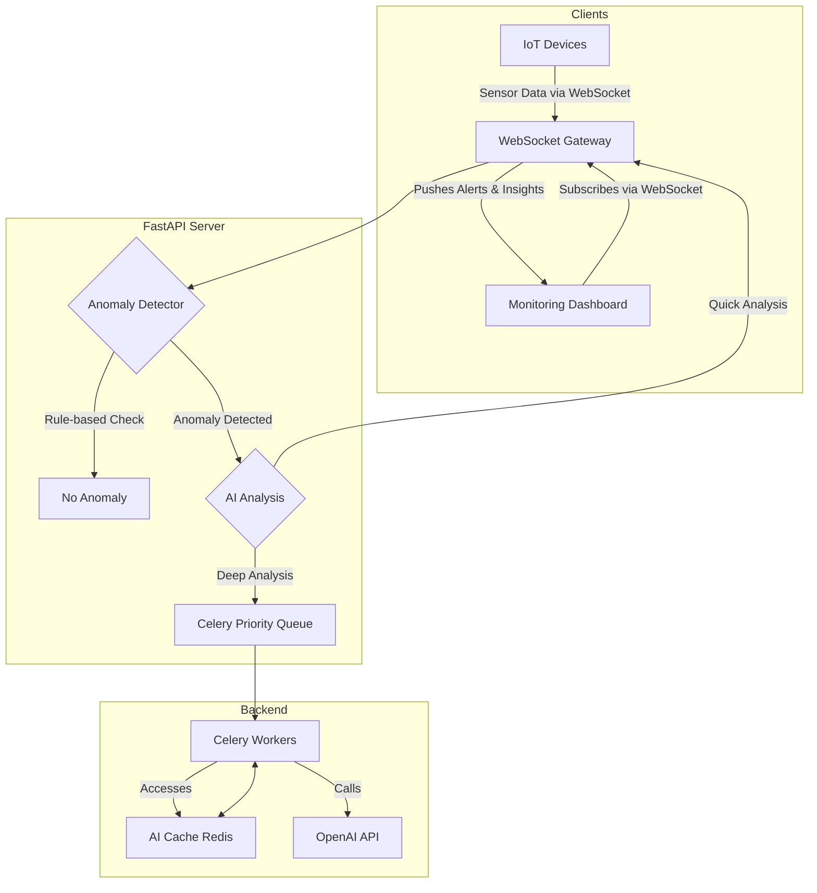

# Chapter 18: Architecting Real-Time AI Applications

In many modern applications, "fast" is not fast enough. We need "now." Imagine an AI monitoring a factory floor; a 30-second delay in analyzing a critical temperature spike could be the difference between a routine adjustment and a costly failure. This is the domain of real-time AI.

First, a reality check on latency. An LLM call typically takes from a few hundred milliseconds to many seconds, and reasoning models can take longer; the time varies from call to call and depends on a third-party service. That rules LLMs out of hard real-time control loops (stopping a machine within milliseconds, high-frequency trading). The real-time architectures in this chapter therefore follow one principle: **fast, deterministic code handles the critical path; LLMs add analysis and explanation off to the side**, as quickly as they can.

Real-time AI systems are designed to process data, reason, and act with minimal latency. They don't just respond to user requests; they react to a constantly changing world. This chapter will guide you through the architectural patterns and technologies required to build these highly responsive, event-driven AI applications. We will transform our thinking from the simple request-response model to a continuous, asynchronous flow.

### Learning Objectives

By the end of this chapter, you will be able to:

-   Understand the fundamental challenges of building low-latency AI systems.
-   Implement WebSocket connections for persistent, bidirectional communication.
-   Offload long-running AI tasks to background workers using Celery and Redis.
-   Design and implement multi-level caching strategies to dramatically reduce AI response times.
-   Build robust rate limiting and priority queuing systems to manage load and prevent system overload.
-   Architect a complete, real-time IoT anomaly detection system from scratch.

## The Challenge of Real-Time

The traditional, synchronous approach to software development is fundamentally at odds with the demands of real-time systems. Let's examine a naive monitoring function to understand why.

```python
import time
import openai

client = openai.OpenAI()
MODEL = "gpt-6-luna"

# A synchronous, blocking approach. This is NOT suitable for real-time.
def traditional_monitoring(sensor_readings):
    print(f"Starting analysis of {len(sensor_readings)} readings...")
    start_time = time.time()
    
    for reading in sensor_readings:
        # Each API call blocks the entire process for one to several seconds.
        client.responses.create(model=MODEL, input=f"Analyze this reading: {reading}")
        print(f"Analyzed reading {reading['id']}.")

    print(f"Finished in {time.time() - start_time:.2f} seconds.")
```

This simple loop has several fatal flaws for a real-time application:

1.  **Blocking Operations:** Each API call is a network request that blocks all other work until it completes. If you have 10 readings, the system is frozen for the entire duration.
2.  **Sequential Processing:** Readings are analyzed one by one. An urgent, critical alert could be stuck waiting behind nine routine checks.
3.  **No Resilience:** If the fifth API call fails, the entire loop might crash, leaving the remaining readings unanalyzed.
4.  **Inefficiency:** The same patterns might be analyzed repeatedly, wasting time and money on redundant API calls.

To build a true real-time system, we must solve each of these problems.

## WebSockets: The Heartbeat of Real-Time Communication

The foundation of any real-time web application is a persistent, two-way communication channel between the client and the server. While HTTP is a transactional request-response protocol, **WebSockets** provide a continuous, open "phone line."

This means the server can push data to the client *instantly*, without waiting for the client to ask for it. This is essential for live dashboards, chat applications, and monitoring systems.

Let's build a simple WebSocket server with FastAPI that can manage connections from multiple clients.

### A Central Connection Manager

First, we need a class to keep track of all active WebSocket connections.

```python
from fastapi import FastAPI, WebSocket, WebSocketDisconnect
import asyncio

class ConnectionManager:
    """A singleton class to manage active WebSocket connections."""
    def __init__(self):
        self.active_connections: dict[str, WebSocket] = {}

    async def connect(self, websocket: WebSocket, client_id: str):
        """Accepts and stores a new client connection."""
        await websocket.accept()
        self.active_connections[client_id] = websocket
        print(f"Client connected: {client_id}. Total: {len(self.active_connections)}")

    def disconnect(self, client_id: str):
        """Removes a client connection."""
        if client_id in self.active_connections:
            del self.active_connections[client_id]
            print(f"Client disconnected: {client_id}. Total: {len(self.active_connections)}")

    async def broadcast(self, message: str):
        """Sends a message to all connected clients, dropping any that have gone away."""
        # Iterate over a copy: disconnect() modifies the dict.
        for client_id, connection in list(self.active_connections.items()):
            try:
                await connection.send_text(message)
            except Exception:   # the socket died without a clean disconnect
                self.disconnect(client_id)

# Create a single, global instance of the manager
manager = ConnectionManager()
```

### The WebSocket Endpoint

Now, we create a FastAPI endpoint that uses this manager. The `@app.websocket` decorator defines a route that handles WebSocket connections.

```python
app = FastAPI()

@app.websocket("/ws/{client_id}")
async def websocket_endpoint(websocket: WebSocket, client_id: str):
    await manager.connect(websocket, client_id)
    try:
        while True:
            # The server waits here for a message from the client.
            data = await websocket.receive_text()
            
            # For this example, we'll just echo the message back to all clients.
            await manager.broadcast(f"Client #{client_id} says: {data}")
    except WebSocketDisconnect:
        manager.disconnect(client_id)
```

This simple structure is the core of real-time interactivity. A client sends a message, and the server can instantly react and push updates to any or all connected clients.

## Offloading Work: Background Task Processing with Celery

Some AI tasks, like analyzing a full day's worth of sensor data, are too slow to run inside a real-time request loop. Executing a 30-second task would freeze your WebSocket connection. The solution is to offload these long-running jobs to a **background task processor**.

**Celery** is the industry standard for this in the Python ecosystem. It allows you to define tasks that can be executed asynchronously by a separate pool of "worker" processes.

### Setting Up a Celery Task

First, we define a task in a separate file, `celery_app.py`. This task will perform a deep analysis of historical device data.

```python
# In celery_app.py
from celery import Celery
import time

# Configure Celery to use Redis as a message broker and result backend.
app = Celery(
    'ai_tasks',
    broker='redis://localhost:6379/0',
    backend='redis://localhost:6379/1'
)

@app.task
def analyze_historical_data(device_id: str):
    """A long-running task to analyze historical data."""
    print(f"Starting deep analysis for {device_id}...")
    # Simulate a long AI analysis process
    time.sleep(15) 
    analysis_report = f"Comprehensive analysis for {device_id} complete. No major issues found."
    print(f"Finished deep analysis for {device_id}.")
    return {"device_id": device_id, "report": analysis_report}
```

To run this, you need two separate processes:
1.  **Celery Worker:** `celery -A celery_app worker --loglevel=info` (This process listens for tasks).
2.  **FastAPI Server:** `uvicorn main:app --reload` (This process submits tasks).

### Triggering Background Tasks from FastAPI

Now, our FastAPI endpoint can trigger this background task without blocking. It immediately returns a `task_id` to the client, who can use it to check the status of the job later.

```python
# In your main FastAPI app file
from celery_app import analyze_historical_data

@app.post("/analysis/start/{device_id}")
async def start_analysis(device_id: str):
    """Triggers a long-running background analysis task."""
    print(f"Submitting deep analysis task for {device_id} to Celery.")
    # .delay() sends the task to the Celery queue.
    task = analyze_historical_data.delay(device_id)
    return {"message": "Analysis started.", "task_id": task.id}

@app.get("/analysis/status/{task_id}")
async def get_analysis_status(task_id: str):
    """Checks the status and result of a background task."""
    task_result = analyze_historical_data.AsyncResult(task_id)
    
    if task_result.ready():
        return {"status": "COMPLETE", "result": task_result.get()}
    else:
        return {"status": "IN_PROGRESS"}
```

This architecture is fundamental to building responsive systems. The web server stays light and fast, handling only quick interactions, while heavy computational work is delegated to a robust, scalable backend system.

## Smart Caching for AI Responses

AI API calls are the biggest performance bottleneck and cost center in most AI applications. A smart caching strategy is not just an optimization; it's a necessity.

We'll build a multi-level cache:
-   **L1 Cache (In-Memory):** A small, per-process cache for ultra-fast access to recently used items. It must be **bounded** (or it grows until the process runs out of memory) and must **expire** entries (or it keeps serving answers that Redis has already expired).
-   **L2 Cache (Redis):** A distributed cache shared by all server instances that survives application restarts.

```python
import hashlib
import json
from cachetools import TTLCache   # pip install cachetools

class AICache:
    """A two-level cache for AI responses."""
    def __init__(self, redis_client, l1_size: int = 1_000, l1_ttl_seconds: int = 60):
        self.redis = redis_client      # create with decode_responses=True so values come back as str
        self.memory_cache = TTLCache(maxsize=l1_size, ttl=l1_ttl_seconds)   # bounded, expiring L1

    def _generate_key(self, request: dict) -> str:
        """Hash of every parameter that affects the output (model, instructions, input...)."""
        return hashlib.sha256(json.dumps(request, sort_keys=True).encode()).hexdigest()

    def get(self, request: dict) -> str | None:
        key = self._generate_key(request)
        if key in self.memory_cache:                      # 1. fast L1
            return self.memory_cache[key]
        cached = self.redis.get(f"ai_cache:{key}")        # 2. shared L2
        if cached is not None:
            self.memory_cache[key] = cached               # promote to L1
        return cached

    def set(self, request: dict, response: str, ttl_seconds: int = 3600):
        key = self._generate_key(request)
        self.memory_cache[key] = response
        self.redis.setex(f"ai_cache:{key}", ttl_seconds, response)
```

Keep the L1 lifetime short: each server has its own copy, so after an update one server may serve an older answer than another until its L1 entry expires.

By wrapping our AI calls in this cache, we avoid re-computing answers to repeated requests, improving speed and reducing costs. Choose lifetimes per use case: an explanation of "normal operating parameters" can be cached for a long time, while the analysis of a live critical alert should usually not be cached at all, because the situation it describes is changing.

## Managing Load: Rate Limiting and Priority Queues

A popular real-time system can be easily overwhelmed with requests. We need mechanisms to control the flow of traffic.

1.  **Rate Limiting:** Prevents a single user from overwhelming the system. We can implement a "token bucket" algorithm using Redis to track how many requests a user has made in a given time window.

2.  **Priority Queuing:** Not all tasks are equally important. When the system is under heavy load, we should process a "critical safety alert" before a "routine data summary." A priority queue, easily implemented with Redis Sorted Sets, ensures that high-priority tasks are processed first, even if they were submitted later.

Let's see how a priority queue can be implemented.

```python
import json
import time
from typing import Optional

class PriorityQueue:
    def __init__(self, redis_client):
        self.redis = redis_client
        self.queue_name = "ai_task_queue"

    def enqueue(self, task: dict, priority: int):
        """Adds a task to the queue. Higher priority numbers are processed first."""
        # The score is a combination of priority and time to ensure FIFO within a priority level.
        score = priority * 1e12 - time.time() 
        self.redis.zadd(self.queue_name, {json.dumps(task): score})

    def dequeue(self) -> Optional[dict]:
        """Removes and returns the highest-priority task."""
        # zpopmax is atomic and returns the item with the highest score.
        task_data = self.redis.zpopmax(self.queue_name)
        if task_data:
            # zpopmax returns a list of (member, score) tuples
            return json.loads(task_data[0][0])
        return None
```

This queue is self-contained: you would run your own worker processes that loop on `dequeue()`. (Because members are JSON strings, give each task a unique ID; two identical tasks would otherwise collapse into one entry.) If you use Celery instead, you don't need a custom queue: Celery supports priorities natively (with RabbitMQ's priority queues, or emulated on Redis), and the simplest robust design is often separate queues, such as `critical` and `routine`, with dedicated workers for the critical one, so urgent work never waits behind a backlog.

## Complete System: Real-Time IoT Anomaly Detection

Let's bring all these concepts together to build our target application: a system that ingests a real-time stream of IoT sensor data and uses AI to detect anomalies.



The workflow is as follows:

1.  IoT devices stream sensor readings to the FastAPI server via a WebSocket connection.
2.  An `AnomalyDetector` class performs an initial, fast, rule-based check (e.g., `if temperature > 90`).
3.  If a potential anomaly is found, it's placed in a priority queue for AI analysis.
4.  A Celery worker picks up the task from the queue.
5.  The worker first checks the `AICache` to see if this exact pattern has been analyzed recently.
6.  If not, it calls the OpenAI API to get a detailed analysis and diagnosis.
7.  The result is stored in the cache.
8.  The final insight is broadcast via the `ConnectionManager` to all subscribed dashboards, appearing on screen in near real-time.

This architecture is robust, scalable, and responsive. It uses cheap, fast computation for initial filtering and reserves expensive, slow AI analysis for the most important events, all while providing a real-time experience to the end-user.

## Key Takeaways

-   LLM calls take hundreds of milliseconds to many seconds and vary from call to call, so keep them off the critical path: fast, deterministic code (such as a rule-based threshold check) makes the real-time decision, and the LLM adds analysis and explanation alongside it.
-   A `ConnectionManager` that tracks open WebSockets lets the server push updates to every client instantly; iterate over a copy of the connections when broadcasting and drop any socket that fails to send.
-   Long-running AI work belongs in background workers: the API submits a Celery task with `.delay()`, returns a `task_id` immediately, and the client checks status later, so the web process stays responsive.
-   A two-level cache (bounded, expiring in-memory L1 plus shared Redis L2) keyed on a hash of every parameter that affects the output cuts latency and cost; keep the L1 TTL short, and don't cache analyses of live, changing situations such as active critical alerts.
-   Control load with per-user rate limiting and priority handling, either a Redis sorted set scored by priority and time or, more simply, separate `critical` and `routine` queues with dedicated workers, so urgent work never waits behind a backlog.

## Exercises

**1. Warm-up:** Rewrite `traditional_monitoring` so that it analyzes a list of 10 readings concurrently with `openai.AsyncOpenAI()` and `asyncio.gather`, and so that one failed call is logged and skipped instead of crashing the loop (use `return_exceptions=True` or a `try`/`except` per reading). Time both versions on the same readings. Done means the concurrent version finishes in roughly the time of the slowest single call, and when you force one reading to fail (for example by sending an oversized input), the other nine results are still printed.

**2. Build:** Put the `AICache` class in front of a real model call and prove it works. Write a small test script that sends the same request three times and a slightly different request (different model or instructions) once, and records for each call whether it was an L1 hit, L2 hit, or miss, plus its latency. Done means the output shows miss, L1 hit, L1 hit for the repeated request and a miss for the changed one, and after restarting the script (empty L1) the first repeated request is an L2 hit.

**3. Stretch:** Build the front of the anomaly detection pipeline: a WebSocket endpoint that receives JSON sensor readings, runs a rule-based `AnomalyDetector` (for example temperature above 90 or a jump of more than 15 degrees since the last reading), and enqueues only anomalies into the `PriorityQueue`, with priority 10 for critical readings and 1 for warnings. Write a simulator that sends 1,000 readings, about 2% of them anomalous, and a worker loop that calls `dequeue()`. Done means you can report how many readings reached the queue versus how many arrived, and a test shows that a critical reading enqueued after 20 warnings is dequeued first.

# References and Further Reading

- WebSockets (FastAPI documentation): https://fastapi.tiangolo.com/advanced/websockets/
- First Steps with Celery (Celery documentation): https://docs.celeryq.dev/en/main/getting-started/first-steps-with-celery.html
- Real-time machine learning: challenges and solutions (Chip Huyen): https://huyenchip.com/2022/01/02/real-time-machine-learning-challenges-and-solutions.html
- Agents as Escalators: Real-time AI Video Monitoring with Amazon Bedrock Agents and Video Streams (AWS): https://aws.amazon.com/blogs/machine-learning/agents-as-escalators-real-time-ai-video-monitoring-with-amazon-bedrock-agents-and-video-streams/
- Rate limits (OpenAI API documentation): https://developers.openai.com/api/docs/guides/rate-limits

<!-- chapter-nav -->

---

[← Chapter 17: Building AI-Powered Web Applications with Python](17-building-ai-powered-web-applications.md) | [Table of Contents](../README.md) | [Chapter 19: AI Application Architecture Patterns →](19-ai-application-architecture-patterns.md)
