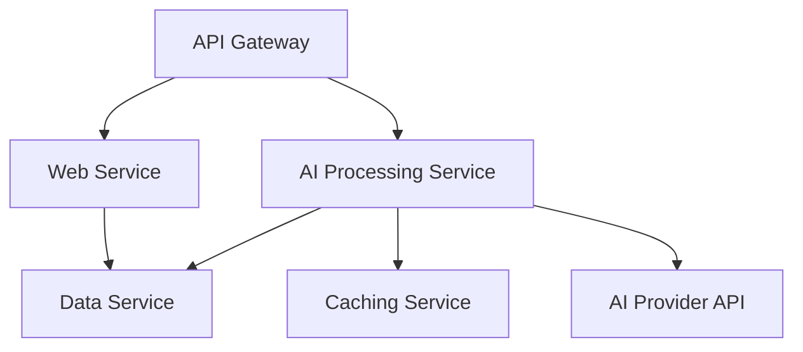
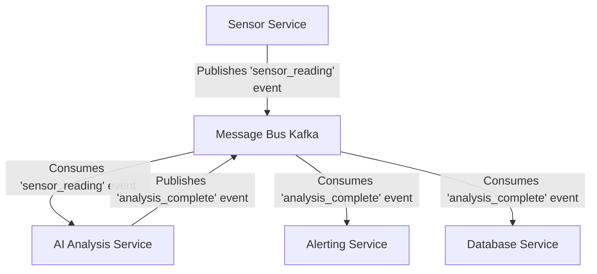
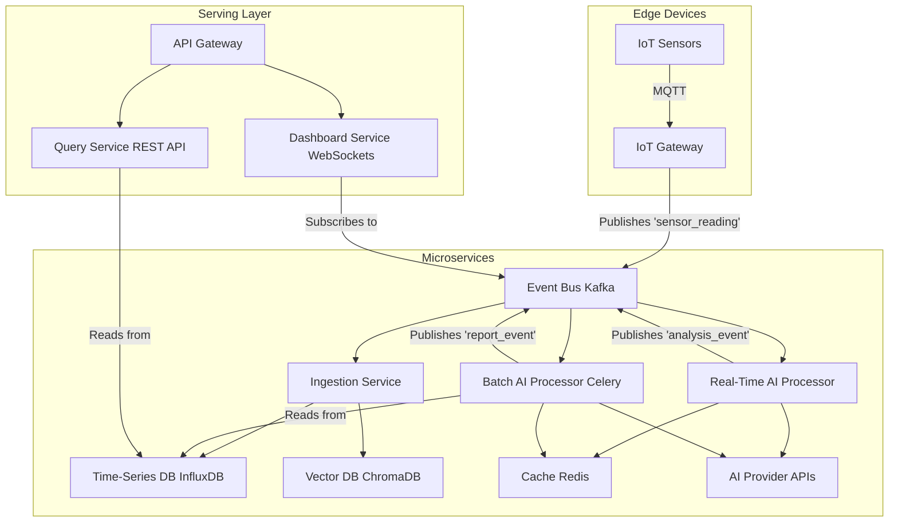

# Chapter 19: AI Application Architecture Patterns

Building a successful AI application involves more than just writing clever prompts. As your application grows from a simple script to a production system, its underlying architecture becomes the single most important factor determining its scalability, reliability, and maintainability. AI-powered systems present unique architectural challenges—variable latency, high computational costs, and complex state management—that traditional software architectures are often ill-equipped to handle.

This chapter is your blueprint for designing robust and scalable AI application architectures. We will explore key patterns, from the trade-offs between monoliths and microservices to the power of event-driven systems. You will learn how to choose the right database for your AI data, manage complex configurations, and build a complete IoT analytics platform from the ground up that embodies these modern architectural principles.

### Learning Objectives

By the end of this chapter, you will be able to:

-   Understand why a thoughtful architecture is critical for production AI applications.
-   Design and contrast monolithic and microservices-based AI architectures.
-   Build scalable, event-driven AI systems using a message bus like Kafka.
-   Choose the right database patterns (e.g., polyglot persistence) for diverse AI data types.
-   Implement sophisticated, centralized configuration management for prompts, models, and keys.
-   Architect a complete, production-ready IoT analytics platform that integrates these patterns.

## Why Architecture Matters for AI Applications

A simple AI script might feel fast and easy, but it hides the complexities that emerge at scale. A production architecture must address:

-   **Variable Latency:** An AI API call can take milliseconds or several seconds. Your system must not block or hang while waiting.
-   **High Resource Usage:** AI models, especially when self-hosted, consume significant CPU, GPU, and memory. This workload needs to be isolated from other parts of your application.
-   **Complex State:** Conversations, user context, and feedback data must be managed, persisted, and made available to the AI.
-   **Cost Control:** Every API call has a cost. The architecture must include mechanisms for caching, rate limiting, and optimizing calls.
-   **Model Versioning:** AI models are constantly evolving. Your architecture must allow you to test and deploy new models and prompts without rewriting the entire application.
-   **Resilience:** Third-party APIs can fail. Your system needs to be resilient, with retries, failovers, and graceful degradation.

## The First Big Decision: Monolith vs. Microservices

Every application starts with a choice: build it as a single, unified application (a monolith) or as a collection of smaller, independent services (microservices).

### The AI Monolith: Simple and Fast to Start

For a new project or a small team, a monolith is often the right choice. All your code—web server, AI logic, database access, caching—lives in a single application.

**Advantages:**
-   **Simplicity:** Easy to develop, test, and deploy.
-   **Speed:** No network latency between components.
-   **Low Overhead:** No need for complex orchestration or service discovery.

Here's what a simple AI monolith using FastAPI might look like:

```python
# A simple, monolithic AI application using FastAPI.
# All logic (API, AI call, caching, database) is in one file.
import hashlib

import openai
import redis
from fastapi import FastAPI, HTTPException
from pydantic import BaseModel

# --- All components initialized in one place ---
app = FastAPI(title="AI Monolith")
openai_client = openai.OpenAI()
redis_client = redis.Redis(host='localhost', port=6379, decode_responses=True)
MODEL = "gpt-6-luna"

# --- Request/Response Models ---
class AnalysisRequest(BaseModel):
    text: str

class AnalysisResponse(BaseModel):
    original_text: str
    analysis: str
    cached: bool

# --- API Endpoint ---
# A plain `def` endpoint: FastAPI runs it in a thread pool, so the blocking
# OpenAI and Redis clients don't stall the event loop (see Chapter 17).
@app.post("/analyze", response_model=AnalysisResponse)
def analyze_text(request: AnalysisRequest):
    """Analyzes a piece of text using AI, with caching."""
    
    # 1. Caching Logic (hash the text: raw user text makes unbounded, unsafe keys)
    cache_key = f"analysis:{MODEL}:{hashlib.sha256(request.text.encode()).hexdigest()}"
    cached_result = redis_client.get(cache_key)
    if cached_result:
        print("Cache Hit!")
        return AnalysisResponse(
            original_text=request.text,
            analysis=cached_result,
            cached=True
        )

    print("Cache Miss. Calling AI...")
    # 2. AI Logic
    try:
        ai_analysis = openai_client.responses.create(
            model=MODEL,
            instructions="You are a concise analyst.",
            input=f"Analyze this: {request.text}",
        ).output_text
    except openai.OpenAIError:
        raise HTTPException(status_code=503, detail="AI service unavailable")
    
    # 3. Database Logic (Simplified)
    # In a real app, you would save the analysis to a database here.
    print("Saving to database...")

    # Update cache
    redis_client.setex(cache_key, 3600, ai_analysis) # Cache for 1 hour

    return AnalysisResponse(
        original_text=request.text,
        analysis=ai_analysis,
        cached=False
    )
```
This is perfectly fine for getting started, but as the application grows, its limitations become apparent. You can't scale the AI processing independently of the web server, and a failure in one component can bring down the entire system.

### Microservices: Scalability and Resilience

A microservices architecture breaks the application into small, independent services, each with a single responsibility.


-   **API Gateway:** The single entry point for all client requests. It routes traffic to the appropriate service.
-   **AI Processing Service:** A dedicated service that owns all model calls: prompts, provider clients, retries, caching, and cost tracking. When it calls hosted APIs it needs no GPUs, just enough concurrency; its scaling limit is usually the provider's rate limits. Only if you self-host models does this service run on GPU machines, and then isolating it from the rest of the system matters even more.
-   **Data Service:** Manages all interactions with the database.
-   **Caching Service:** A centralized cache (like Redis) used by other services.

**Advantages:**
-   **Independent Scaling:** You can add more instances of the AI service during peak load without scaling the web server.
-   **Resilience:** If the AI service fails, the rest of the application (e.g., serving historical data) can remain operational.
-   **Technology Flexibility:** Your AI service can be written in Python, while a data ingestion service could be in Go for higher performance.

The primary drawback is increased complexity. You now need service discovery (like Consul), inter-service communication (like gRPC or REST calls), and more sophisticated deployment orchestration.

## Event-Driven Architecture: The AI-Native Pattern

For many AI applications, a purely request-response model is inefficient. An **event-driven architecture**, built around a central **message bus** (like Apache Kafka or RabbitMQ), is often a better fit.

In this model, services don't call each other directly. Instead, they produce and consume **events**.



**Workflow:**
1.  A `Sensor Service` receives a new reading and publishes a `sensor_reading` event to the message bus. Its job is done.
2.  The `AI Analysis Service` is subscribed to this event. It picks up the message, performs its analysis (which could take time), and then publishes a new `analysis_complete` event containing the AI's insights.
3.  An `Alerting Service` and a `Database Service` are both subscribed to `analysis_complete` events. They pick up the result and act independently—one sends an alert, the other writes to the database.

**Why this pattern is perfect for AI:**
-   **Asynchronous Processing:** The initial service doesn't have to wait for the AI analysis to complete. This is ideal for handling the variable latency of AI calls.
-   **Decoupling:** Services are completely independent. You can add a new service (e.g., a `Billing Service` that listens to `analysis_complete` events) without changing any existing services.
-   **Scalability & Resilience:** You can run multiple instances of the `AI Analysis Service` to process events in parallel. If one instance fails, another can pick up the work.

## Database Patterns: Polyglot Persistence

AI applications generate and consume a wide variety of data types, and a one-size-fits-all database is rarely the optimal choice. The **polyglot persistence** pattern advocates for using multiple, specialized databases, each chosen for its suitability for a specific type of data.

-   **PostgreSQL (Relational Database):** Ideal for structured, transactional data like user accounts, device metadata, and billing information. Its support for JSONB also makes it flexible.
-   **MongoDB (Document Database):** Perfect for storing unstructured or semi-structured data like conversation histories or complex JSON outputs from AI models. Its flexible schema is a huge advantage.
-   **Redis (In-Memory Key-Value Store):** The go-to choice for caching, session management, and implementing rate limiters and queues. Its speed is unmatched.
-   **Vector Databases (e.g., ChromaDB, Pinecone):** Essential for storing and searching **embeddings**. They are optimized for finding the "nearest neighbors" in high-dimensional space, powering semantic search and recommendation engines.
-   **Time-Series Databases (e.g., InfluxDB, TimescaleDB):** Specifically designed for handling timestamped data like IoT sensor readings or application metrics, making time-based queries incredibly fast.

A mature AI architecture may use several of these databases together. But every additional database is another system to operate, secure, back up, and keep consistent, so start with fewer. PostgreSQL covers a surprising amount on its own: relational data, JSONB documents, vector search through the `pgvector` extension, and time series through TimescaleDB. A common, pragmatic path is "Postgres plus Redis" first, adding a specialized store only when you have measured that Postgres can't meet a specific need.

## Configuration Management for AI Systems

AI applications have more complex configuration needs than traditional software. You need to manage:
-   API keys for multiple providers (securely!).
-   Model names (`gpt-6-luna`, `claude-sonnet-5-5`, etc.), which change several times a year as providers release and retire models.
-   Model parameters (reasoning effort, output limits, and sampling settings where supported).
-   **Prompts:** Prompts are a form of source code! They need to be versioned, tested, and dynamically updated without redeploying your application.
-   Feature flags to A/B test different models or prompts.

A robust configuration system should be:
-   **Centralized:** A single source of truth (e.g., a Git repository, Consul, or a dedicated config service).
-   **Hierarchical:** Allow for default settings with environment-specific overrides (e.g., `development`, `staging`, `production`).
-   **Dynamic:** Allow for changes to be loaded without restarting the application.
-   **Secure:** Keep API keys out of config files entirely; load them from a secrets manager (Chapter 22).

Let's use Pydantic and YAML files to build a simple but powerful configuration manager.

```python
# config_manager.py
from pathlib import Path
from typing import Literal

import yaml
from pydantic import BaseModel, model_validator

# Define the structure of our configs with Pydantic
class ModelProfile(BaseModel):
    provider: Literal["openai", "anthropic", "google"]
    model: str                                   # the provider's model ID
    reasoning_effort: Literal["low", "medium", "high"] = "medium"
    max_output_tokens: int = 4096

class PromptConfig(BaseModel):
    version: str
    template: str
    model_profile: str                           # name of a ModelProfile

class Config(BaseModel):
    models: dict[str, ModelProfile]
    prompts: dict[str, PromptConfig]

    @model_validator(mode="after")
    def prompts_reference_known_models(self):
        for name, prompt in self.prompts.items():
            if prompt.model_profile not in self.models:
                raise ValueError(f"Prompt '{name}' references unknown model profile '{prompt.model_profile}'")
        return self

class ConfigManager:
    """Loads every YAML file in a directory and validates the merged result."""
    def __init__(self, config_dir: str = "./config"):
        self.config_path = Path(config_dir)
        self.config = self._load_config()

    def _load_config(self) -> Config:
        merged: dict = {}
        for file_path in sorted(self.config_path.glob("*.yaml")):
            data = yaml.safe_load(file_path.read_text()) or {}
            for section, entries in data.items():          # merge per section, not per file
                merged.setdefault(section, {}).update(entries)
        return Config.model_validate(merged)               # fails fast, with a clear error, on bad config

    def get_prompt(self, name: str) -> PromptConfig:
        return self.config.prompts[name]

    def get_model(self, name: str) -> ModelProfile:
        return self.config.models[name]
```

The YAML files mirror the schema (each file contributes to the top-level `models` and `prompts` sections):

```yaml
# config/models.yaml
models:
  fast_and_cheap:
    provider: openai
    model: gpt-6-luna
    reasoning_effort: low
  deep_analysis:
    provider: anthropic
    model: claude-opus-5-5
    reasoning_effort: high
```

```yaml
# config/prompts.yaml
prompts:
  summarize_report:
    version: "2026-10-01"
    template: "Summarize this report concisely: {report_text}"
    model_profile: fast_and_cheap
  root_cause_analysis:
    version: "2026-09-15"
    template: "Find the most likely root cause of this incident: {incident}"
    model_profile: deep_analysis
```

This pattern separates prompts and model choices from application logic. Because the config is validated at startup, a typo (an unknown profile name, a missing model ID) stops the deployment instead of failing on the first user request. Version each prompt and record the version in your logs (Chapter 23), so you can tell which prompt produced which output. Teams that change prompts often go further, with a prompt registry or the prompt-management features of LLM observability platforms, but a validated, version-controlled YAML file is an excellent start.

## Complete Architecture: A Scalable IoT Analytics Platform

Let's bring all these patterns together to design a production-ready IoT analytics platform.


**Workflow:**
1.  **Ingestion:** IoT sensors send data via MQTT to an `IoT Gateway`, which publishes a `sensor_reading` event to Kafka.
2.  **Real-Time Path:**
    -   The `Real-Time AI Processor` consumes the event.
    -   It checks a Redis **cache**. If the data pattern is new, it calls an AI API for a quick anomaly score.
    -   It publishes an `analysis_event` with the score.
    -   The `Dashboard Service` consumes this event and pushes an update to connected users via **WebSockets**.
3.  **Batch Path:**
    -   A scheduled `Batch AI Processor` (using Celery) runs periodically (e.g., every hour).
    -   It pulls the last hour of data from the **Time-Series DB**.
    -   It performs a deep, expensive analysis to find long-term trends and generates a report.
    -   It publishes a `report_event`.
4.  **Data Storage:** An `Ingestion Service` also listens for `sensor_reading` events and writes the raw data to a **Time-Series DB** and any text-based logs to a **Vector DB** (after creating embeddings) for semantic search.
5.  **Configuration:** All services load their configuration (prompts, model names, etc.) from a centralized **Config Manager**.

This architecture effectively separates concerns, enabling independent scaling, resilience, and the use of the best technology for each specific job. It is a robust blueprint for building high-performance, enterprise-grade AI applications.

## Key Takeaways

-   Start with a monolith: one FastAPI app with the model call, a Redis cache keyed on a hash of the input, and the database is easy to build, test, and deploy. Split out an AI processing service only when you need to scale or isolate it independently.
-   A dedicated AI service owns all model calls (prompts, clients, retries, caching, cost tracking); with hosted APIs its scaling limit is usually the provider's rate limits, not CPU or GPUs.
-   Event-driven architecture fits AI's variable latency: services publish and consume events such as `sensor_reading` and `analysis_complete` on a message bus, so producers never wait on analysis and new consumers can be added without changing existing services.
-   Polyglot persistence picks a store per data type (relational, document, key-value, vector, time series), but every database is another system to operate; "Postgres plus Redis" (with JSONB, `pgvector`, and TimescaleDB) covers most needs until measurements say otherwise.
-   Treat prompts and model IDs as versioned configuration: load them from YAML into Pydantic models, validate cross-references at startup so a typo stops the deployment, keep API keys in a secrets manager, and log the prompt version with every output.

## Exercises

**1. Warm-up:** Set up the `ConfigManager` with the two YAML files from this chapter and write three small tests: one that loads the valid config, one where a prompt references a profile name that doesn't exist, and one where `reasoning_effort` is set to an invalid value such as `"extreme"`. Done means the first test passes and the other two fail at load time with a Pydantic `ValidationError` whose message names the offending field or prompt.

**2. Build:** Refactor the monolith's `/analyze` endpoint to take its instructions, model ID, and reasoning effort from the `ConfigManager` instead of hard-coded values, and include the prompt version in both the cache key and the response. Change the prompt's `version` and `template` in YAML and restart. Done means a request sent before the change and the same request after it produce different cache keys (the second is a cache miss), and the response body shows which prompt version produced each answer.

**3. Stretch:** Build a minimal event-driven pipeline without Kafka: use a Redis list (or Redis Streams) as the bus, with a sensor publisher that emits `sensor_reading` events, an AI analysis consumer that publishes `analysis_complete` events, and two independent subscribers (an alerting printer and a writer that appends results to a JSON Lines file). Then stop the AI consumer, publish 20 readings, and start it again. Done means all 20 readings are eventually analyzed and stored with no publisher changes, and adding a third subscriber (for example a cost counter) requires no edits to the existing services.

# References and Further Reading

- Building A Generative AI Platform (Chip Huyen): https://huyenchip.com/2024/07/25/genai-platform.html
- Microservices (James Lewis and Martin Fowler): https://martinfowler.com/articles/microservices.html
- Architectural Patterns to Build End-to-End Data Driven Applications on AWS (AWS Whitepaper): https://docs.aws.amazon.com/whitepapers/latest/build-e2e-data-driven-applications/build-e2e-data-driven-applications.pdf
- Settings Management (Pydantic documentation): https://pydantic.dev/docs/validation/2.12/concepts/pydantic_settings/

<!-- chapter-nav -->

---

[← Chapter 18: Architecting Real-Time AI Applications](18-real-time-ai-applications.md) | [Table of Contents](../README.md) | [Chapter 20: Scaling AI Applications →](20-scaling-ai-applications.md)
