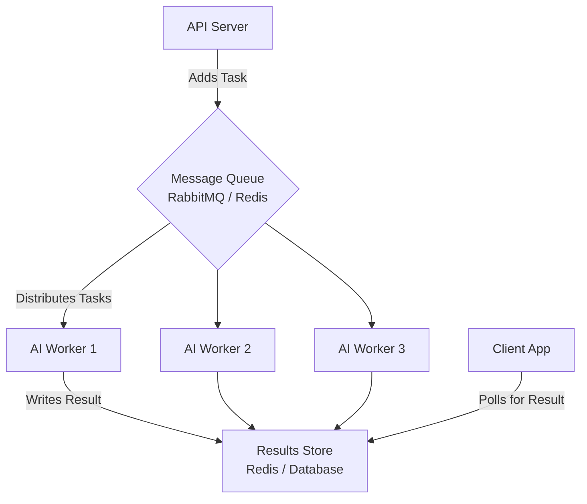
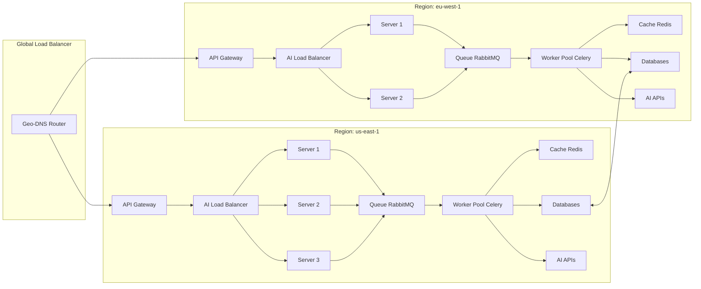

# Chapter 20: Scaling AI Applications

Building a proof-of-concept AI application is an exciting first step. Making it run for ten, a thousand, or a million users is an entirely different engineering discipline. Scaling AI applications presents a unique set of challenges that go beyond traditional web scaling. The variable latency of AI models, their intensive resource consumption, and the constant pressure of API costs require a specialized architectural approach.

This chapter is your guide to building AI systems that are not just smart, but also scalable, resilient, and cost-effective. We will explore the patterns that allow applications to handle massive workloads gracefully, from horizontal scaling and queue-based architectures to advanced caching and database optimizations. By the end, you will understand how to design and build an AI-powered platform capable of operating at a global scale.

### Learning Objectives

By the end of this chapter, you will be able to:

-   Understand the unique scaling challenges posed by AI applications.
-   Implement horizontal scaling strategies, including load balancing with session affinity.
-   Design queue-based, asynchronous architectures to handle variable AI processing times.
-   Architect a microservices system that allows AI components to scale independently.
-   Optimize database designs for the specific demands of AI-heavy workloads.
-   Build a complete, globally-scalable IoT platform architecture.

## The Scaling Challenge: Why AI is Different

A traditional web application often scales predictably: more users mean more database queries and more server load. Scaling an AI application is more complex.

Let's look at a "bad" example to see what happens when we apply traditional thinking to an AI problem. This server will quickly fail under load.

```python
# A demonstration of what NOT to do. This will not scale.
from fastapi import FastAPI
import openai

app = FastAPI()
client = openai.OpenAI()
MODEL = "gpt-6-luna"

# BAD: Global, in-memory state. This will not work across multiple servers
# and will be lost on restart. Memory will also grow indefinitely.
conversations = {} 

@app.post("/analyze/{device_id}")
async def analyze_data_naively(device_id: str, data: dict):
    """This endpoint demonstrates several critical scaling anti-patterns."""
    
    # 1. Blocking call inside an async endpoint: it freezes the event loop, so
    #    every other request on this worker waits until the model responds.
    analysis = client.responses.create(model=MODEL, input=f"Analyze this data: {data}").output_text
    
    # 2. Unbounded Memory: This dictionary grows with every conversation,
    #    eventually leading to an out-of-memory crash.
    if device_id not in conversations:
        conversations[device_id] = []
    conversations[device_id].append(analysis)
    
    return {"analysis": analysis}

# Problems with this approach:
# - A few long-running AI calls can block all other requests.
# - The server has no protection against API rate limits.
# - It's inefficient and costly, with no caching.
# - The in-memory state makes horizontal scaling impossible.
```

To build a scalable system, we must address each of these issues with specific architectural patterns.

## The First Bottleneck Is Usually Not Your Servers

For applications built on hosted model APIs, an API server that does nothing but wait on network calls can handle a lot of concurrent requests (with async code, thousands). The limit you hit first is usually your **provider rate limits**: requests per minute and tokens per minute, set per model and per account tier. Plan for them explicitly:

-   **Know your limits and your demand.** Estimate peak tokens per minute (requests × average input and output tokens) and compare with your quota. Ask for higher limits or a higher tier *before* launch day.
-   **Spread load.** Different models have separate quotas, and you can route simple requests to a cheaper model (Chapter 21). Some providers and clouds offer reserved or provisioned throughput for guaranteed capacity.
-   **Move work off the request path.** Anything that isn't interactive belongs in a queue (below) or in a Batch API job, which has its own, larger quota.
-   **Shed load gracefully.** When you are near the limit, queue or reject low-priority work and keep a fallback provider ready (Chapter 8), rather than letting every request fail with 429 errors.

## Horizontal Scaling: More Servers, Not Bigger Servers

**Horizontal scaling** (scaling out) means adding more server instances to handle the load, as opposed to **vertical scaling** (scaling up), which means making a single server more powerful. For AI, horizontal scaling is almost always the right choice, but it requires careful design to manage state and route requests intelligently.

### An Intelligent AI Load Balancer

A standard load balancer might just distribute requests randomly. An AI-aware load balancer is smarter. It needs to consider:
-   **Server Health:** Is the server online and responding?
-   **Current Load:** How many concurrent requests is a server already handling?
-   **Session Affinity (Sticky Sessions):** Routing all messages of a conversation to the same server.

A word of caution about stickiness. With hosted APIs, your servers should be **stateless**: keep conversation history in Redis or a database, so any server can handle any request and a server can die without losing conversations. Then sticky sessions are unnecessary. Affinity does pay off when you **self-host models**, because inference servers such as vLLM cache the processed prefix of a conversation (its "KV cache") in GPU memory, and routing follow-up turns to the same replica reuses that work. Treat affinity as an optimization, never as the place where state lives.

Let's design a class that simulates such a load balancer.

```python
import aiohttp
import asyncio
import time
from typing import List, Dict, Optional

class ServerInstance:
    """Represents a single AI processing server instance."""
    def __init__(self, server_id: str, url: str, max_concurrent: int):
        self.id = server_id
        self.url = url
        self.max_concurrent = max_concurrent
        self.healthy = True
        self.current_load = 0

class AILoadBalancer:
    """A load balancer designed for AI workloads with session affinity."""
    def __init__(self):
        self.servers: Dict[str, ServerInstance] = {}
        # Maps a conversation_id to a specific server_id for sticky sessions
        self.conversation_affinity: Dict[str, str] = {}

    def add_server(self, server_id: str, url: str, max_concurrent: int = 10):
        """Adds a new server to the pool."""
        self.servers[server_id] = ServerInstance(server_id, url, max_concurrent)
        print(f"Server '{server_id}' added to the pool.")
        
    async def get_best_server(self, conversation_id: Optional[str] = None) -> ServerInstance:
        """Selects the best server for a new request."""
        
        # 1. Check for conversation affinity (sticky sessions)
        if conversation_id and conversation_id in self.conversation_affinity:
            server_id = self.conversation_affinity[conversation_id]
            if server_id in self.servers and self.servers[server_id].healthy:
                return self.servers[server_id]

        # 2. Find all healthy servers with available capacity
        available_servers = [
            s for s in self.servers.values() 
            if s.healthy and s.current_load < s.max_concurrent
        ]
        
        if not available_servers:
            raise Exception("All servers are currently at capacity.")
            
        # 3. Choose the server with the lowest current load
        best_server = min(available_servers, key=lambda s: s.current_load)
        
        # 4. If this is part of a conversation, "stick" it to this server
        if conversation_id:
            self.conversation_affinity[conversation_id] = best_server.id
            
        return best_server

    # A health check loop would run in the background to update server.healthy status.
```

This logic sends new requests to the least busy server and keeps ongoing conversations on the same server when it is healthy. (In this simulation, `current_load` would be incremented when a request starts and decremented when it finishes.) In practice you rarely write this yourself: load balancers such as NGINX, Envoy, or your cloud provider's offer least-connections routing, health checks, and consistent-hash affinity as configuration.

## The Queue-Based Architecture: Taming Variable Latency

The single biggest challenge in scaling AI applications is the highly variable processing time. A queue-based architecture is the definitive solution to this problem. Instead of processing requests synchronously, you place them in a queue, and a separate pool of workers processes them at their own pace.



### Implementing a Queue System with Celery and Redis

**Celery** is a powerful distributed task queue for Python. Combined with **Redis** as a message broker, it provides a production-ready system for asynchronous AI processing.

First, we define our AI task in `tasks.py`:

```python
# tasks.py
from celery import Celery
import openai

app = Celery('ai_tasks', broker='redis://localhost:6379/0', backend='redis://localhost:6379/0')
client = openai.OpenAI(max_retries=0)   # Celery owns the retry policy; don't stack two (Chapter 8)

# Retry transient API failures with backoff; acks_late re-queues the task if a worker crashes mid-task.
@app.task(
    autoretry_for=(openai.RateLimitError, openai.APIConnectionError, openai.InternalServerError),
    retry_backoff=True, max_retries=5, acks_late=True,
)
def long_running_ai_analysis(prompt: str) -> str:
    """An AI task that can be run in the background by a Celery worker."""
    print(f"Worker starting analysis for prompt: '{prompt[:30]}...'")
    response = client.responses.create(
        model="gpt-6-sol",                 # a more capable, slower model is fine off the request path
        input=prompt,
        reasoning={"effort": "high"},
    )
    print("Worker finished analysis.")
    return response.output_text
```
Next, our FastAPI application submits jobs to this queue instead of running them directly.

```python
# main.py
from typing import Optional

from celery.result import AsyncResult
from fastapi import FastAPI
from pydantic import BaseModel

from tasks import long_running_ai_analysis

app = FastAPI()

class TaskRequest(BaseModel):
    prompt: str

class TaskStatus(BaseModel):
    task_id: str
    status: str
    result: Optional[str] = None

@app.post("/tasks", status_code=202)
def submit_task(request: TaskRequest):
    """Submits a task to the queue and immediately returns a task ID."""
    task = long_running_ai_analysis.delay(request.prompt)
    return {"task_id": task.id, "status": "submitted"}

@app.get("/tasks/{task_id}", response_model=TaskStatus)
def get_task_status(task_id: str):
    """Checks the status of a background task."""
    task_result = AsyncResult(task_id, app=long_running_ai_analysis.app)
    
    result = task_result.result if task_result.ready() else None
    
    return TaskStatus(task_id=task_id, status=task_result.status, result=result)
```

To run this system, you need three commands in separate terminals:
1.  `redis-server` (To run the Redis message broker)
2.  `celery -A tasks worker --loglevel=info` (To start the AI worker)
3.  `uvicorn main:app --reload` (To run the API server)

This architecture decouples the web server from the AI workers, allowing each to be scaled independently. You can add more AI workers to increase your processing throughput without affecting the responsiveness of your API.

## Database Design for AI at Scale

As we saw in the previous chapter, using the right database for the right job (polyglot persistence) is crucial. At scale, the specific design within those databases also matters.

-   **Time-Series Data (IoT Readings):** Use **partitioning** (in PostgreSQL) or **hypertables** (in TimescaleDB). This splits a massive table into smaller, time-based chunks (e.g., one table per day or month). Queries for recent data only need to scan the latest chunk, making them incredibly fast, while older data is kept online for historical analysis.

-   **AI Analysis Results (JSON Blobs):** Store these in a document database like **MongoDB** or a PostgreSQL `JSONB` column. Create indexes on key fields within the JSON that you frequently query (e.g., `device_id`, `analysis_type`, `model_name`).

-   **Vector Embeddings:** At scale, a simple `numpy` search is too slow. Use an approximate-nearest-neighbor index, either in PostgreSQL with `pgvector` or in a dedicated **vector database** such as Weaviate, Qdrant, Pinecone, or ChromaDB. These databases use specialized indexing algorithms (like HNSW) to perform lightning-fast similarity searches on millions or billions of vectors.

## Caching at Scale: A Multi-Level Approach

Caching is your most powerful tool for managing both cost and latency. A production system should use a multi-level caching strategy.

-   **L1 Cache (In-Memory):** A simple dictionary within each application instance. Fastest possible access, but small and not shared.
-   **L2 Cache (Distributed Cache - Redis):** A shared cache accessible by all your application instances. Slower than in-memory but ensures consistency across your cluster.
-   **L3 Cache (Disk-based):** For very large cacheable items that don't fit in Redis, a shared network file system can be used.

```python
# A conceptual multi-level cache for an AI service
class MultiLevelCache:
    def __init__(self, redis_client):
        self.l1_cache = {} # In-memory dictionary
        self.l2_cache = redis_client # Redis client

    def get(self, key):
        # 1. Try L1 first
        if key in self.l1_cache:
            return self.l1_cache[key]
        
        # 2. Try L2 if L1 misses
        l2_result = self.l2_cache.get(key)
        if l2_result is not None:
            # Promote to L1 for future requests
            self.l1_cache[key] = l2_result
            return l2_result
            
        return None # Cache miss on all levels

    def set(self, key, value):
        self.l1_cache[key] = value
        self.l2_cache.setex(key, 3600, value) # Cache in Redis for 1 hour
```

### Semantic Caching

A powerful, AI-specific caching technique is **semantic caching**. Instead of caching based on the exact prompt (an exact-match key), you cache based on the *meaning* of the prompt.

**Workflow:**
1.  When a new request comes in, generate an embedding for the user's prompt.
2.  Search your vector database for existing prompts with a similar meaning (a high cosine similarity).
3.  If a sufficiently similar prompt is found, return its cached response instead of making a new API call.

This can raise your cache hit rate, because paraphrased questions with the same intent can share an answer. It also carries a real risk: **sentences that differ only in a crucial detail are often extremely similar in embedding space.** "What is the status of sensor T-101?" and "What is the status of sensor T-102?" may score above any sensible threshold, and the second user gets the first sensor's status. Use semantic caching only for content that doesn't depend on such details (general FAQs, documentation questions), add exact-match checks for entities like IDs, dates, and numbers, and measure the false-hit rate on real traffic before enabling it (Chapter 21).

## A Complete, Scalable IoT Platform Architecture

Let's bring all these patterns together to design a globally-scalable IoT platform.



**Key Features of this Architecture:**
-   **Global Load Balancing:** A Geo-DNS router sends users to the nearest regional deployment (e.g., `us-east-1`, `eu-west-1`) for low latency.
-   **Regional Independence:** Each region is a self-contained copy of the application, with its own API gateway, load balancer, servers, queue, and workers.
-   **Horizontal Scaling in Each Region:** The AI server pool (`S1`, `S2`, `S3`) and the worker pool (`W`) can be scaled independently based on load.
-   **Asynchronous Processing:** All heavy AI work is handled by the Celery worker pool via the RabbitMQ queue, keeping the API servers fast and responsive.
-   **Shared State:** Caches (Redis) and Databases (PostgreSQL, Vector DBs, etc.) are shared within a region. Replication keeps selected data in sync across regions.
-   **High Availability:** If the entire `us-east-1` region goes down, the Geo-DNS can automatically reroute traffic to `eu-west-1`.
-   **Data Residency:** Regions are also a compliance boundary. Personal data of EU users may need to stay in the EU (GDPR), so decide deliberately what replicates across regions, and which model endpoints each region may call; several providers offer region-specific processing for this reason.

This architecture is complex, but it is built from the simple patterns we've discussed. It provides the foundation for an AI application that can serve millions of users globally with high performance and reliability.

## Key Takeaways

-   With hosted model APIs, the first limit you hit is usually provider rate limits (requests and tokens per minute), not your servers; estimate peak tokens per minute against your quota before launch, and plan to spread, queue, or shed load rather than fail with 429s.
-   Scale out with stateless servers: keep conversation history in Redis or a database so any instance can serve any request. Session affinity is an optimization (worth it mainly for self-hosted inference that reuses a KV cache), never the place where state lives.
-   A queue-based architecture tames variable latency: the API returns 202 with a task ID, Celery workers process jobs at their own pace with `autoretry_for` on transient errors, backoff, and `acks_late`, and workers scale independently of the API.
-   Let one layer own retries: set `max_retries=0` on the client when Celery retries the task, so failures don't multiply.
-   At scale, partition time-series tables (or use TimescaleDB hypertables), index the JSON fields you query, and use an approximate-nearest-neighbor index (HNSW in `pgvector` or a vector database) for embeddings.
-   Semantic caching can raise hit rates but can return the wrong answer for prompts that differ in one crucial detail (T-101 vs. T-102); restrict it to detail-independent content, add exact-match checks for IDs and numbers, and measure the false-hit rate first.

## Exercises

**1. Warm-up:** Estimate your rate-limit headroom for the IoT platform. Assume 5,000 devices that each trigger one analysis per hour at peak, with 800 input and 300 output tokens per call, and compute requests per minute and tokens per minute; then send 20 real requests, record `response.usage` for each, and redo the estimate with your measured averages. Done means you have both numbers side by side with your account's actual limits for the model and can say how many devices you could support before hitting the token limit.

**2. Build:** Run the Celery `tasks.py` and `main.py` system and make it survive failure. Add a test mode to the task that raises `openai.APIConnectionError` on its first two attempts, submit 10 tasks, and kill the worker process (Ctrl+C or `kill -9`) while some tasks are running, then restart it. Done means all 10 tasks eventually reach `SUCCESS`, the worker logs show the retries with increasing delays, and no task is lost by the crash.

**3. Stretch:** Make `MultiLevelCache` production-ready and measure it. Replace the plain dict L1 with a bounded, expiring `cachetools.TTLCache` (as in Chapter 18), hash the request parameters into the key, and add hit/miss counters for each level; then replay a workload of 500 requests drawn from 50 distinct prompts against two app instances sharing one Redis. Done means you report the L1 and L2 hit rates for each instance, the number of model calls actually made (it should be close to 50), and a check confirming memory stays bounded when you replay 10,000 distinct prompts.

# References and Further Reading

- Rate limits (OpenAI API documentation): https://developers.openai.com/api/docs/guides/rate-limits
- How to handle rate limits (OpenAI Cookbook): https://developers.openai.com/cookbook/examples/how_to_handle_rate_limits
- Exponential Backoff And Jitter (AWS Architecture Blog): https://aws.amazon.com/blogs/architecture/exponential-backoff-and-jitter/
- Task options: retries and acks_late (Celery documentation): https://docs.celeryq.dev/en/latest/reference/celery.app.task.html
- Semantic caching (RedisVL documentation): https://redis.io/docs/latest/integrate/redisvl/user-guide/semantic-caching

<!-- chapter-nav -->

---

[← Chapter 19: AI Application Architecture Patterns](19-ai-application-architecture-patterns.md) | [Table of Contents](../README.md) | [Chapter 21: AI Application Cost Optimization →](21-cost-optimization.md)
