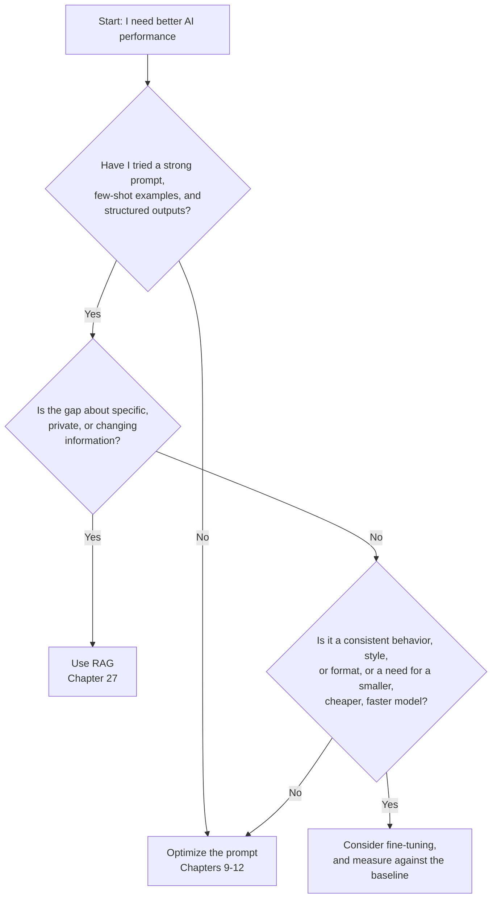

# Chapter 26: Fine-Tuning and Custom Models

You have become skilled at prompting. You can guide, constrain, and persuade general-purpose models to perform impressive feats, and you know how to build applications that are reliable, observable, and secure. But what do you do when a task needs a specialized behavior, style, or format that prompting can't deliver consistently, or when a large model is simply too slow or expensive for a narrow, high-volume task?

That is the territory of **fine-tuning**: taking a pre-trained model and training it further on your own examples. Fine-tuning is not a good way to teach a model new *facts*; it is a way to teach it a *behavior*, such as a format, a style, a classification scheme, or a way of handling a task, and often to let a much smaller, cheaper model do a job that previously needed a large one.

This chapter covers *when* to fine-tune, *how* to prepare data, how to run and evaluate a fine-tuning job, and where you can do it today.

### Learning Objectives

By the end of this chapter, you will be able to:

-   Choose between prompt engineering, RAG, and fine-tuning for a given problem.
-   Identify the use cases where fine-tuning provides real value.
-   Prepare a high-quality training dataset in the standard chat format.
-   Understand the workflow of a fine-tuning job on a hosted platform and on open-weight models.
-   Evaluate a fine-tuned model against a strong prompted baseline before deploying it.

> **Platform status (October 2026).** The fine-tuning landscape changed significantly in 2026. OpenAI announced in May 2026 that its fine-tuning platform is no longer available to new users (existing users can still create jobs for a limited period, and existing fine-tuned models keep working until their base models are retired). The main options today are:
>
> -   **Open-weight models** (for example the Llama, Qwen, Gemma, Mistral, and gpt-oss families) fine-tuned with parameter-efficient methods such as **LoRA/QLoRA**, using libraries like Hugging Face TRL and PEFT or Unsloth, on your own GPUs or a rented cloud GPU, and served with an inference server such as vLLM;
> -   **Managed tuning on cloud AI platforms** (for example Google's Vertex AI, Amazon Bedrock, and Azure AI Foundry), which support tuning for selected models;
> -   **Specialized fine-tuning services** that train and host open-weight models for you.
>
> The decision framework, the data preparation, and the evaluation discipline in this chapter apply to all of them. Check your chosen platform's current documentation for supported models and exact APIs.

## When to Fine-Tune (and When NOT To)

Fine-tuning is powerful but costs time and money, adds a model you must maintain, and ties you to a base model that will eventually be retired. It is usually *not* the first tool to reach for. Before you consider it, ask:

1.  Can I achieve this with better **prompt engineering**, including few-shot examples and Structured Outputs?
2.  Is this really a **knowledge** problem that retrieval (RAG, Chapter 27) solves better?



### When NOT to Fine-Tune

-   **For factual recall:** Fine-tuning is an unreliable way to teach a model new facts. It may learn to *sound* like it knows your product while still inventing details. If your application must answer questions about documents, use RAG, which can also cite its sources.
-   **For simple style changes:** "Be more formal" or "answer in bullet points" is a one-line instruction, not a training job.
-   **For rapidly changing information:** A fine-tuned model is frozen at training time.
-   **When you don't have an evaluation:** Without a test set that measures the behavior you want, you can't tell whether fine-tuning helped, or hurt something else.

### When Fine-Tuning Is the Right Choice

Fine-tuning shines when you need to change *how* a model behaves, consistently, often at scale:

1.  **Consistent format or style** that is hard to maintain with prompting alone, such as a strict house style, or a complex proprietary output structure.
2.  **Specialized classification or extraction**, where the categories depend on subtle, organization-specific judgment that is easier to show with hundreds of examples than to describe.
3.  **Domain language**: jargon, abbreviations, and conventions of a specialized field (industrial error logs, clinical shorthand), *as a skill of reading and writing them*, not as a store of facts.
4.  **Cost and latency (distillation):** Use a large model, or human experts, to produce high-quality outputs, then fine-tune a small model to reproduce them. A well-tuned small model can match a much larger one on a *narrow* task at a fraction of the cost and latency.

## The Fine-Tuning Workflow

Whatever the platform, the workflow has the same five steps, and most of the work is in the first one.

### Step 1: Data Preparation

The quality of a fine-tuned model depends almost entirely on the quality of its training data. You need examples that demonstrate exactly the behavior you want.

The near-universal format is **JSON Lines (`.jsonl`)** in the chat-messages structure: one JSON object per line, each containing a full example conversation. Hosted platforms and open-source trainers such as TRL accept this format directly or with minimal conversion.

Let's create a dataset to teach a model to classify IoT log messages:

```json
{"messages": [{"role": "system", "content": "Classify the IoT log. Categories: Connectivity, Power, Sensor_Fault, Security. Reply with the category only."}, {"role": "user", "content": "GW-01 failed to connect to MQTT broker after 3 retries."}, {"role": "assistant", "content": "Connectivity"}]}
{"messages": [{"role": "system", "content": "Classify the IoT log. Categories: Connectivity, Power, Sensor_Fault, Security. Reply with the category only."}, {"role": "user", "content": "Battery level on SENSOR-112 is at 4%. Immediate action required."}, {"role": "assistant", "content": "Power"}]}
{"messages": [{"role": "system", "content": "Classify the IoT log. Categories: Connectivity, Power, Sensor_Fault, Security. Reply with the category only."}, {"role": "user", "content": "Temperature reading on TEMP-08 is -999.0."}, {"role": "assistant", "content": "Sensor_Fault"}]}
{"messages": [{"role": "system", "content": "Classify the IoT log. Categories: Connectivity, Power, Sensor_Fault, Security. Reply with the category only."}, {"role": "user", "content": "Multiple failed login attempts from IP 1.2.3.4 for ADMIN-PANEL."}, {"role": "assistant", "content": "Security"}]}
```

**Key data principles:**
-   **Quality over quantity, but enough of it:** a few hundred carefully reviewed examples are a typical starting point for a classification or formatting task; platforms set minimums (often at least 10), and results usually keep improving into the thousands, as long as quality holds.
-   **Cover the real distribution:** include the hard and ambiguous cases, and keep the class balance close to what you see in production.
-   **Consistency:** the assistant outputs must be exactly what you want the model to produce, including formatting. Inconsistent labels teach inconsistency.
-   **Hold out data:** set aside a validation set and a separate test set that are never used for training.
-   **Keep it clean and lawful:** remove personal data you don't need, and make sure you have the right to train on the data.

A script to build and split the dataset:

```python
import json
import random

SYSTEM = "Classify the IoT log. Categories: Connectivity, Power, Sensor_Fault, Security. Reply with the category only."

def to_example(log: str, label: str) -> dict:
    return {"messages": [
        {"role": "system", "content": SYSTEM},
        {"role": "user", "content": log},
        {"role": "assistant", "content": label},
    ]}

def write_jsonl(examples: list[dict], path: str) -> None:
    with open(path, "w") as f:
        for example in examples:
            f.write(json.dumps(example) + "\n")

labelled_logs = [
    ("GW-01 failed to connect to MQTT broker after 3 retries.", "Connectivity"),
    ("Battery level on SENSOR-112 is at 4%.", "Power"),
    # ... hundreds more, reviewed by someone who knows the domain ...
]

random.seed(42)
random.shuffle(labelled_logs)
n = len(labelled_logs)
train = labelled_logs[: int(n * 0.8)]
validation = labelled_logs[int(n * 0.8): int(n * 0.9)]
test = labelled_logs[int(n * 0.9):]          # used only for the final evaluation

write_jsonl([to_example(*x) for x in train], "train.jsonl")
write_jsonl([to_example(*x) for x in validation], "validation.jsonl")
```

### Steps 2–4: Upload, Train, and Monitor

On a hosted platform, the next steps are always: upload the training (and validation) files, start a job on a chosen base model, and wait while it trains, from minutes to hours. For reference, this is what the steps look like with OpenAI's API, for teams that still have access; other hosted platforms follow the same shape.

```python
import openai

client = openai.OpenAI()

# 2. Upload the data files.
train_file = client.files.create(file=open("train.jsonl", "rb"), purpose="fine-tune")
validation_file = client.files.create(file=open("validation.jsonl", "rb"), purpose="fine-tune")

# 3. Start the job on a fine-tunable base model (see the platform's current list).
job = client.fine_tuning.jobs.create(
    training_file=train_file.id,
    validation_file=validation_file.id,
    model="gpt-4.1-mini",
)
print(f"Job ID: {job.id}")

# 4. Monitor it.
job = client.fine_tuning.jobs.retrieve(job.id)
print(job.status, job.fine_tuned_model)    # when status == "succeeded", fine_tuned_model holds the new model ID
```

With open-weight models, the same steps happen on your own infrastructure: load the base model, attach LoRA adapters (small trainable matrices that leave the original weights frozen, which makes training far cheaper), train on the JSONL data with a trainer such as TRL's `SFTTrainer`, watch the training and validation loss, and save the adapter. LoRA adapters are small files, so you can keep one per task or customer and load them on demand.

Watch the validation loss as you train: if training loss keeps falling while validation loss rises, the model is **overfitting** (memorizing the examples instead of learning the pattern); stop earlier, reduce the number of epochs, or add more varied data.

### Step 5: Use the Model

A fine-tuned model is called like any other model, by its new ID, or, for open-weight models, through your inference server (vLLM and similar servers expose an OpenAI-compatible API, so the client code barely changes).

```python
def classify_log(client, model: str, log: str) -> str:
    response = client.chat.completions.create(       # chat completions: widely supported for tuned models
        model=model,
        messages=[{"role": "system", "content": SYSTEM}, {"role": "user", "content": log}],
    )
    return response.choices[0].message.content.strip()
```

Use the same system prompt at inference time as in training: the model learned to respond to *that* input.

## Evaluating Your Custom Model

A fine-tuned model must earn its place. Compare it, on your held-out **test set**, against the strongest *non-fine-tuned* alternative, usually a capable model with a good prompt and few-shot examples. If the prompted baseline is just as accurate, you don't need the extra model to maintain.

```python
from collections import Counter

def evaluate(predict, test_set: list[tuple[str, str]]) -> dict:
    """Accuracy plus a confusion count for a classifier. `predict` maps a log to a label."""
    confusion = Counter()
    correct = 0
    for log, expected in test_set:
        predicted = predict(log)
        correct += predicted == expected
        confusion[(expected, predicted)] += 1
    return {"accuracy": correct / len(test_set), "confusion": dict(confusion)}

FEW_SHOT = SYSTEM + "\nExamples:\n- 'Uplink lost on GW-4' -> Connectivity\n- 'Cell voltage 2.1V' -> Power"

def baseline_predict(log: str) -> str:
    return client.responses.create(model="gpt-6-luna", instructions=FEW_SHOT, input=log).output_text.strip()

# baseline = evaluate(baseline_predict, test)
# tuned = evaluate(lambda log: classify_log(client, "ft:your-model-id", log), test)
# Ship the tuned model only if it is clearly better, or equally good and cheaper/faster at your volume.
```

Look beyond the headline accuracy: the confusion counts show *which* mistakes each model makes (mistaking Security events for Connectivity is worse than the reverse), and you should also compare latency and cost per request at your expected volume. For generative tasks (style, formatting), use the LLM-judge approach from Chapter 24, calibrated against human ratings.

## A Cautionary Example: Proprietary Error Codes

Here is a request that sounds like a perfect fine-tuning project, and isn't: "Our *AquaSense 300* water monitors emit proprietary error codes (`E-01`, `E-02`, `W-10`, …). Fine-tune a model so it knows what every code means."

It's tempting: the information isn't public, and a model can't know it. But this is **factual recall**, exactly what fine-tuning does poorly:

-   With one example per code, the model may memorize the training phrasing yet still confuse similar codes, or confidently invent a meaning for a code it never saw.
-   When engineering adds `E-12` next month, you would have to retrain.
-   You can't point the user to the source of an answer.

The robust design is much simpler. For a small, fixed table, look the code up in code and let the model explain the result; for a large manual, use RAG (Chapter 27):

```python
AQUASENSE_CODES = {
    "E-01": {"problem": "pH sensor calibration drift", "action": "Run remote recalibration (RECALIB_PH). If it fails, schedule a technician."},
    "E-02": {"problem": "Turbidity sensor occlusion", "action": "Trigger the cleaning cycle (CLEAN_TURB). Inspect for debris if it persists."},
    "W-10": {"problem": "Low battery (below 15%)", "action": "Replace the battery within 7 days."},
}

def explain_error(code: str, user_question: str) -> str:
    entry = AQUASENSE_CODES.get(code.upper())
    if entry is None:
        return f"Error code {code} is not in the AquaSense 300 reference. Please check the code or contact support."
    return client.responses.create(
        model="gpt-6-luna",
        instructions="You are an AquaSense 300 support assistant. Explain using only the reference entry provided.",
        input=f"Reference for {code}: {json.dumps(entry)}\n\nUser question: {user_question}",
    ).output_text

print(explain_error("E-02", "My unit is showing E-02. What's wrong?"))
```

Unknown codes get an honest answer instead of an invented one, updates are a one-line change, and every explanation is grounded in the reference. Fine-tuning *could* still play a role later, for example teaching a small model your support team's tone and answer structure, but the facts stay in the lookup table or the retrieval index.

## Conclusion

Fine-tuning is a powerful tool, best used deliberately:

-   **Prompting first:** strong prompts, few-shot examples, and structured outputs solve most problems.
-   **RAG for facts:** use retrieval when the model needs specific, private, or changing information.
-   **Fine-tune for behavior and efficiency:** consistent formats and styles, specialized classification, domain language, and distilling a large model's skill into a small, cheap one.
-   **Data and evaluation are everything:** curate examples carefully, hold out a test set, and ship only what beats the prompted baseline.
-   **Plan for platform change:** prefer approaches (like open-weight LoRA adapters plus a reproducible training script) that you can re-run when a base model or platform goes away.

## Key Takeaways

-   Work through the decision tree in order: a strong prompt with few-shot examples and Structured Outputs first, RAG when the gap is knowledge, and fine-tuning only for a consistent behavior, format, or classification scheme, or to distill a task into a smaller, cheaper model.
-   Fine-tuning teaches behavior, not facts. Proprietary data such as the AquaSense error codes belongs in a lookup table or a retrieval index, where unknown codes get an honest answer and updates are a one-line change.
-   Training data is chat-format JSONL. Keep labels exactly consistent, cover the hard cases and the real class balance, split into train, validation, and test sets (80/10/10 in the chapter's script), and use the same system prompt at inference time as in training.
-   During training, compare training and validation loss: if training loss keeps falling while validation loss rises, the model is overfitting, so stop earlier, use fewer epochs, or add more varied data.
-   A tuned model ships only if it beats the strongest prompted baseline on the held-out test set. Compare confusion counts (which mistakes it makes), latency, and cost per request at your volume, not just headline accuracy.
-   Hosted options shift (OpenAI closed its fine-tuning platform to new users in May 2026), so a reproducible LoRA/QLoRA script on an open-weight model, with TRL or PEFT for training and vLLM for serving, is the most portable path.

## Exercises

**1. Warm-up:** Write a `validate_dataset(paths)` script that checks `train.jsonl` and `validation.jsonl` before any training run: every line parses as JSON, each example has exactly a system, user, and assistant message in that order, the system prompt equals `SYSTEM`, and the assistant content is one of the four categories. It should also print the class counts per file and flag any log text that appears in more than one split. Done means the script reports zero errors on your files, and catches a line you deliberately corrupt (for example a label of `power` instead of `Power`, or a duplicated log in both files).

**2. Build:** Assemble a test set of at least 50 labelled IoT logs, including ambiguous ones such as "GW-03 rebooted after a brownout" (Power or Connectivity?). Run `evaluate` on it twice, once with a zero-shot prompt and once with `FEW_SHOT`, and also record mean latency per call and an estimated cost per 1,000 requests from the token usage. Count any output that is not exactly one of the four category names as wrong, and report how often that happens. Done means a small comparison table plus a written decision on whether fine-tuning is worth attempting, given the bar the prompted baseline sets.

**3. Stretch:** Fine-tune a small open-weight model (1 to 4 billion parameters) with LoRA using TRL's `SFTTrainer` on your `train.jsonl`, logging training and validation loss at least once per epoch, on a rented or free cloud GPU. Serve the adapter with vLLM's OpenAI-compatible server and score it with `classify_log` and `evaluate` on the same test set as the Build exercise. Done means a loss plot on which you mark the epoch where you would stop, a new row in your comparison table, and a ship or no-ship decision justified by accuracy, the confusion counts, latency, and cost.

# References and Further Reading

- [LoRA: Low-Rank Adaptation of Large Language Models (Hu et al., 2021)](https://arxiv.org/abs/2106.09685)
- [QLoRA: Efficient Finetuning of Quantized LLMs (Dettmers et al., 2023)](https://arxiv.org/abs/2305.14314)
- [Hugging Face TRL documentation (SFTTrainer)](https://huggingface.co/docs/trl/)
- [Hugging Face PEFT documentation](https://huggingface.co/docs/peft/)
- [vLLM documentation (serving open-weight models and LoRA adapters)](https://docs.vllm.ai/)
- [Fine-tuning now available for GPT-4o (OpenAI; see the 2026 platform update on this page)](https://openai.com/index/gpt-4o-fine-tuning/)
