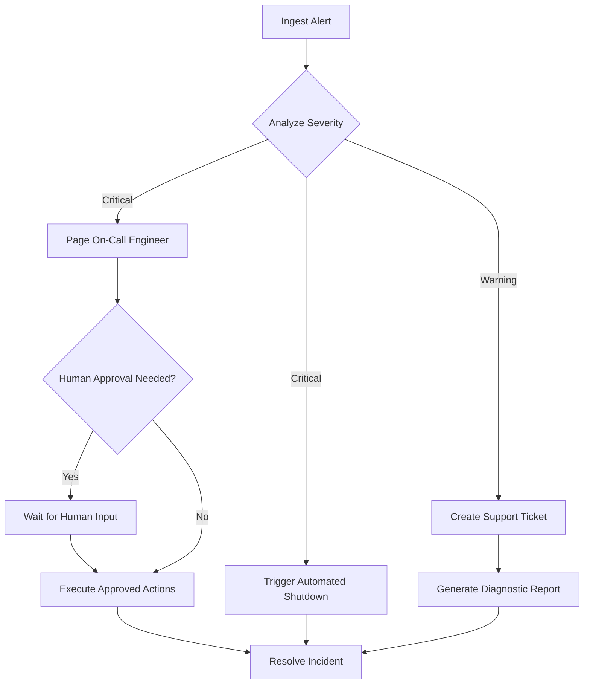

# Chapter 28: AI Workflows and Orchestration

In the preceding chapters, we built agents that use tools, chains that reason in steps, and applications that serve models through robust APIs. Most of these designs followed a straight path: a request comes in, a sequence of steps runs, and a response goes out. Real business processes are rarely so simple. They involve branching logic, parallel tasks, human approvals, waiting, and recovery from failures; in other words, they are **workflows**.

This chapter is about building reliable AI workflows. We will build a small orchestrator from scratch to understand the mechanics (dependencies, data passing, retries, failure handling, and human-in-the-loop steps) and then look at the production engines that provide these features at scale, including **durable execution** for processes that must survive crashes and wait for humans.

### Learning Objectives

By the end of this chapter, you will be able to:

-   Explain the difference between a simple AI chain and a workflow.
-   Model workflows as Directed Acyclic Graphs (DAGs).
-   Build a small workflow orchestrator in Python, with retries and failure propagation.
-   Integrate **Human-in-the-Loop (HITL)** approval for critical decisions.
-   Build an automated IoT incident-response workflow.
-   Choose between a script, a DAG scheduler, and a durable-execution engine.

## From Simple Chains to Workflows

A simple AI chain is like a straight road:

```python
def simple_ai_chain(alert_data: str) -> str:
    summary = ai_summarize(alert_data)        # 1. summarize the alert
    diagnosis = ai_diagnose(summary)          # 2. diagnose the root cause
    return generate_report(diagnosis)         # 3. generate a report
```

That's fine until something goes wrong. What if the diagnosis is uncertain? What if a critical alert needs several actions at once? What if a human must approve before anything changes? What if the API is down for ten minutes?

A workflow is a graph of tasks where the path can branch, steps can run in parallel, and failures are handled deliberately. The standard representation is a **Directed Acyclic Graph (DAG)**:

-   **Directed:** each edge points from a task to a task that depends on it.
-   **Acyclic:** there are no loops, so execution always finishes.



(Agents, by contrast, are loops: the model decides, acts, observes, and decides again. Frameworks for agentic workflows, such as LangGraph, therefore support cycles with explicit stop conditions. A common design is a DAG for the overall process, with an agent loop inside one bounded step.)

## Building a Simple Workflow Orchestrator

To understand how orchestrators work, we'll build a small one. The design choices are the ones every real engine makes: how tasks declare dependencies, how data flows between them, what happens on failure, and how the execution order is computed.

### Step 1: Defining a Task

A task is a function plus the IDs of the tasks it depends on. Every task function has the same signature: it receives `inputs` (a dictionary of its dependencies' results, keyed by task ID) and `params` (the workflow's input parameters). A uniform signature keeps tasks decoupled from each other's names.

```python
import json
import time
from dataclasses import dataclass, field
from graphlib import TopologicalSorter, CycleError
from typing import Any, Callable

TaskFn = Callable[[dict[str, Any], dict[str, Any]], Any]

@dataclass
class Task:
    id: str
    function: TaskFn
    dependencies: list[str] = field(default_factory=list)
    max_retries: int = 0
    retry_delay_seconds: float = 1.0

# Some simple task functions
def ingest_data(inputs: dict, params: dict) -> dict:
    print("TASK: ingest")
    return {"raw_data": params["reading"]}

def analyze_data(inputs: dict, params: dict) -> dict:
    print("TASK: analyze")
    temperature = inputs["ingest"]["raw_data"]["temperature_c"]
    if temperature > 90:
        return {"severity": "Critical", "details": f"{temperature}°C exceeds the 90°C limit."}
    return {"severity": "Normal", "details": "All systems nominal."}

def send_alert(inputs: dict, params: dict) -> dict:
    severity = inputs["analyze"]["severity"]
    print(f"TASK: alert (severity {severity})")
    return {"alert_sent": severity == "Critical"}

def log_to_database(inputs: dict, params: dict) -> dict:
    print(f"TASK: log ({inputs['analyze']['severity']})")
    return {"logged": True}
```

### Step 2: The Orchestrator

The orchestrator computes an execution order in which every task comes after its dependencies (a **topological sort**). Python's standard library includes one, `graphlib.TopologicalSorter`, which also detects cycles. Then it runs each task with retries, and skips the tasks downstream of a failure instead of feeding them bad data.

```python
class WorkflowOrchestrator:
    def __init__(self):
        self.tasks: dict[str, Task] = {}

    def add_task(self, task: Task) -> None:
        self.tasks[task.id] = task

    def _execution_order(self) -> list[str]:
        for task in self.tasks.values():
            missing = [d for d in task.dependencies if d not in self.tasks]
            if missing:
                raise ValueError(f"Task '{task.id}' depends on unknown task(s): {missing}")
        graph = {task_id: set(task.dependencies) for task_id, task in self.tasks.items()}
        return list(TopologicalSorter(graph).static_order())   # raises CycleError on loops

    def _run_with_retries(self, task: Task, inputs: dict, params: dict) -> Any:
        for attempt in range(1, task.max_retries + 2):
            try:
                return task.function(inputs, params)
            except Exception as e:
                if attempt > task.max_retries:
                    raise
                print(f"  ! {task.id} failed (attempt {attempt}): {e}. Retrying in {task.retry_delay_seconds}s")
                time.sleep(task.retry_delay_seconds * attempt)       # simple linear backoff

    def run(self, params: dict | None = None) -> dict[str, dict]:
        params = params or {}
        try:
            order = self._execution_order()
        except (ValueError, CycleError) as e:
            return {"_workflow": {"status": "invalid", "error": str(e)}}
        print("Execution order:", " -> ".join(order))

        state: dict[str, dict] = {}
        for task_id in order:
            task = self.tasks[task_id]
            failed_deps = [d for d in task.dependencies if state[d]["status"] != "success"]
            if failed_deps:
                state[task_id] = {"status": "skipped", "reason": f"upstream failure: {failed_deps}"}
                continue
            inputs = {d: state[d]["result"] for d in task.dependencies}
            try:
                state[task_id] = {"status": "success", "result": self._run_with_retries(task, inputs, params)}
            except Exception as e:
                state[task_id] = {"status": "failed", "error": f"{type(e).__name__}: {e}"}
        return state
```

Let's wire up the tasks and run the workflow:

```python
orchestrator = WorkflowOrchestrator()
orchestrator.add_task(Task("ingest", ingest_data))
orchestrator.add_task(Task("analyze", analyze_data, dependencies=["ingest"]))
orchestrator.add_task(Task("alert", send_alert, dependencies=["analyze"]))
orchestrator.add_task(Task("log", log_to_database, dependencies=["analyze"]))

results = orchestrator.run({"reading": {"device_id": "T-101", "temperature_c": 95}})
print(json.dumps(results, indent=2))
```

The orchestrator runs `ingest`, then `analyze`, then `alert` and `log`. Those last two don't depend on each other and could run in parallel; `TopologicalSorter` also has an incremental API (`get_ready()` / `done()`) that tells you which tasks are ready at each moment, which is how a parallel executor would be built.

## Advanced Workflow Patterns

### Pattern 1: Retries and Failure Propagation

The orchestrator already retries transient failures (`max_retries` per task) and marks downstream tasks as `skipped` when a dependency fails, which is safer than calling them with an error object they don't expect. Two production rules go with retries: only retry **idempotent** tasks (sending the same alert three times is a bug, so give side-effecting tasks a unique key the receiving system can deduplicate on), and distinguish transient errors (retry) from permanent ones (fail fast), as in Chapter 8.

### Pattern 2: Conditional Logic and Branching

Branching is usually expressed by having a task return a decision that downstream tasks check, as `execute_automated_fix` and `escalate_to_engineer` do in the project below. Production engines offer explicit branch operators, but the principle is the same: the decision is data, and it is recorded in the workflow state, so you can see later *why* a path was taken.

### Pattern 3: Human-in-the-Loop (HITL)

This is one of the most important patterns for responsible AI systems. Some decisions are too consequential to automate. An HITL step pauses the workflow until a person approves or rejects.

```python
def human_approval_task(inputs: dict, params: dict) -> dict:
    """Pauses for a human decision. Console version for demonstration."""
    diagnosis = inputs["diagnosis"]
    print("\n--- HUMAN APPROVAL REQUIRED ---")
    print(f"Diagnosis: {diagnosis['summary']}")
    print(f"Proposed action: {diagnosis['action']}")
    while (answer := input("Approve this action? (yes/no): ").strip().lower()) not in ("yes", "no"):
        print("Please answer 'yes' or 'no'.")
    return {"approved": answer == "yes", "approver": "console-operator"}
```

In a real application, the approval request goes to a dashboard, Slack, or a mobile app, and the answer may arrive minutes or days later. A Python process blocked on `input()` can't wait days, and if it crashes or is redeployed while waiting, the workflow is lost. Solving exactly that problem is what durable-execution engines are for (below).

## Practical Project: An Automated IoT Incident-Response Workflow

Let's build a workflow for a critical IoT alert, with enrichment, AI diagnosis, human approval, and conditional follow-up.

```python
import openai
from pydantic import BaseModel

client = openai.OpenAI()

class Diagnosis(BaseModel):
    summary: str
    action: str
    confidence: str      # "low" | "medium" | "high"

def ingest_alert(inputs: dict, params: dict) -> dict:
    print("TASK: ingest alert")
    return {"alert": params["alert"]}

def enrich_with_device_data(inputs: dict, params: dict) -> dict:
    print("TASK: enrich with device history")
    alert = inputs["ingest"]["alert"]
    history = {"maintenance_history": "Last serviced 3 months ago.", "firmware": "v2.1.0"}   # from your database
    return {**alert, **history}

def ai_initial_diagnosis(inputs: dict, params: dict) -> dict:
    print("TASK: AI diagnosis")
    response = client.responses.parse(
        model="gpt-6-luna",
        instructions="You are an IoT reliability engineer. Propose the single safest next action.",
        input=f"<alert>{json.dumps(inputs['enrich'])}</alert>",
        text_format=Diagnosis,
    )
    return response.output_parsed.model_dump()

def execute_automated_fix(inputs: dict, params: dict) -> dict:
    if not inputs["approval"]["approved"]:
        return {"status": "skipped", "message": "Action was not approved."}
    print("TASK: executing approved action")
    return {"status": "success", "message": f"Executed: {inputs['diagnosis']['action']}"}

def escalate_to_engineer(inputs: dict, params: dict) -> dict:
    if inputs["approval"]["approved"]:
        return {"status": "skipped", "message": "Escalation not required."}
    print("TASK: escalating to on-call engineer")
    return {"status": "escalated", "ticket_id": "INC-12345"}

def final_report(inputs: dict, params: dict) -> dict:
    fix, escalation = inputs["automated_fix"], inputs["escalate"]
    if fix["status"] == "success":
        summary = f"Resolved automatically after approval. {fix['message']}"
    elif escalation["status"] == "escalated":
        summary = f"Escalated to engineering. Ticket: {escalation['ticket_id']}"
    else:
        summary = "Incident resolution path unclear; needs review."
    return {"final_summary": summary}

incident = WorkflowOrchestrator()
incident.add_task(Task("ingest", ingest_alert))
incident.add_task(Task("enrich", enrich_with_device_data, ["ingest"]))
incident.add_task(Task("diagnosis", ai_initial_diagnosis, ["enrich"], max_retries=2))
incident.add_task(Task("approval", human_approval_task, ["diagnosis"]))
incident.add_task(Task("automated_fix", execute_automated_fix, ["approval", "diagnosis"]))
incident.add_task(Task("escalate", escalate_to_engineer, ["approval"]))
incident.add_task(Task("report", final_report, ["automated_fix", "escalate"]))

results = incident.run({"alert": {"device_id": "PUMP-07B", "error": "PRESSURE_SPIKE_DETECTED"}})
print("\nFinal report:", results["report"].get("result", results["report"]))
```

The AI step is retried on transient failures, its output is structured (Chapter 11) so downstream code can rely on its fields, nothing happens to the equipment without a human decision, and if any step fails, everything downstream is marked `skipped` with the reason, rather than producing a misleading report.

## Beyond Scratch: Production Workflow Engines

Our orchestrator teaches the core ideas, but production systems should use a dedicated engine. There are two families, and it's worth knowing which one you need:

**DAG schedulers** run pipelines of tasks, typically on a schedule, with retries, a UI, logs, and distributed workers. They are ideal for data and batch-AI pipelines (nightly embedding refreshes, scheduled report generation, evaluation runs).
-   **Airflow:** the most widely used, very mature, with a steeper learning curve.
-   **Prefect:** a modern, Python-native API with dynamic workflows.
-   **Dagster:** organized around the data assets your pipelines produce.

**Durable-execution engines** make a long-running process survive crashes, restarts, and deployments by recording each step's result and replaying from the last completed step. A workflow can wait hours or days for a human approval or an external event, then continue exactly where it left off. This is the right model for business processes with human steps and for long-running agents.
-   **Temporal** is the best-known example; several cloud services and newer frameworks offer similar guarantees, and agent frameworks such as LangGraph provide checkpointing and "interrupts" for pausing an agent until a human responds.

The concepts you have learned (tasks, dependencies, data passing, idempotency, retries, and explicit human approval) carry over directly to all of these tools.

## Conclusion

You can now think beyond single API calls and engineer complete, automated AI workflows.

By mastering workflow orchestration, you can build AI systems that are not just intelligent but also resilient and safely integrated into critical operations.

## Key Takeaways

-   Real-world processes are workflows, best modeled as **DAGs** of tasks with a uniform `(inputs, params)` signature, with agent loops kept inside bounded steps. Python's `graphlib.TopologicalSorter` computes a valid execution order, detects cycles, and its `get_ready()` / `done()` API is the basis for running independent tasks in parallel.
-   An orchestrator **retries** transient failures with backoff, fails fast on permanent ones, and marks every task downstream of a failure as `skipped` with the reason, instead of feeding it bad data.
-   Retry only **idempotent** tasks: give side-effecting steps (alerts, tickets, equipment commands) a unique key the receiving system can deduplicate on.
-   Make AI steps return structured output (`client.responses.parse` with a Pydantic model) so branching code can rely on fields, and record each branch decision as data in the workflow state so you can see later why a path was taken.
-   Put **human-in-the-loop** approval in front of consequential actions. A process blocked on `input()` can't wait days or survive a crash; that is the job of **durable execution** (Temporal, or LangGraph checkpoints and interrupts).
-   Use a DAG scheduler (Airflow, Prefect, Dagster) for scheduled and batch pipelines, and a durable-execution engine for long-running processes with human steps.

## Exercises

**1. Warm-up:** Write pytest tests for `WorkflowOrchestrator`, setting `retry_delay_seconds=0` so they run instantly. Cover three cases: a task that fails twice and then succeeds with `max_retries=2` ends with status `success`; a task that always fails leaves its descendants `skipped` while an independent branch still succeeds; and a two-task cycle returns a `_workflow` status of `invalid`. Done means all three tests pass in under a second, and each one fails if you break the behavior it checks (for example by removing the skip logic).

**2. Build:** Add a `run_parallel(params, max_workers=4)` method that uses `TopologicalSorter`'s `prepare()`, `get_ready()`, and `done()` with a `concurrent.futures.ThreadPoolExecutor`, keeping the same retry, state, and skip semantics as `run()`. Test it with a workflow where `alert` and `log` each sleep for one second after `analyze`. Done means the parallel run takes measurably less time than `run()` on that workflow, both methods produce the same final statuses, and your Warm-up tests pass against both.

**3. Stretch:** Make the incident-response workflow resumable: after each task, write the workflow state to a JSON file named after a run ID, and on a rerun with the same ID skip every task already marked `success`. Replace the console approval with a task that fails with a clear "waiting for approval" status until an `approval.json` file (containing `approved` and `approver`) exists. Done means you can start the workflow, stop it at the approval step, write the approval file, rerun it, and show from a call counter or log that `ai_initial_diagnosis` ran exactly once while the final report is produced. Write two sentences on what this toy still lacks compared to a real durable-execution engine.

# References and Further Reading

- [graphlib: functionality to operate with graph-like structures (Python documentation)](https://docs.python.org/3/library/graphlib.html)
- [Temporal documentation: durable execution](https://docs.temporal.io/)
- [LangGraph documentation: human-in-the-loop](https://docs.langchain.com/oss/python/langgraph/interrupts)
- [Apache Airflow documentation](https://airflow.apache.org/docs/)
- [Prefect documentation](https://docs.prefect.io/)
- [Building effective agents: workflows vs. agents (Anthropic, 2024)](https://www.anthropic.com/engineering/building-effective-agents)
