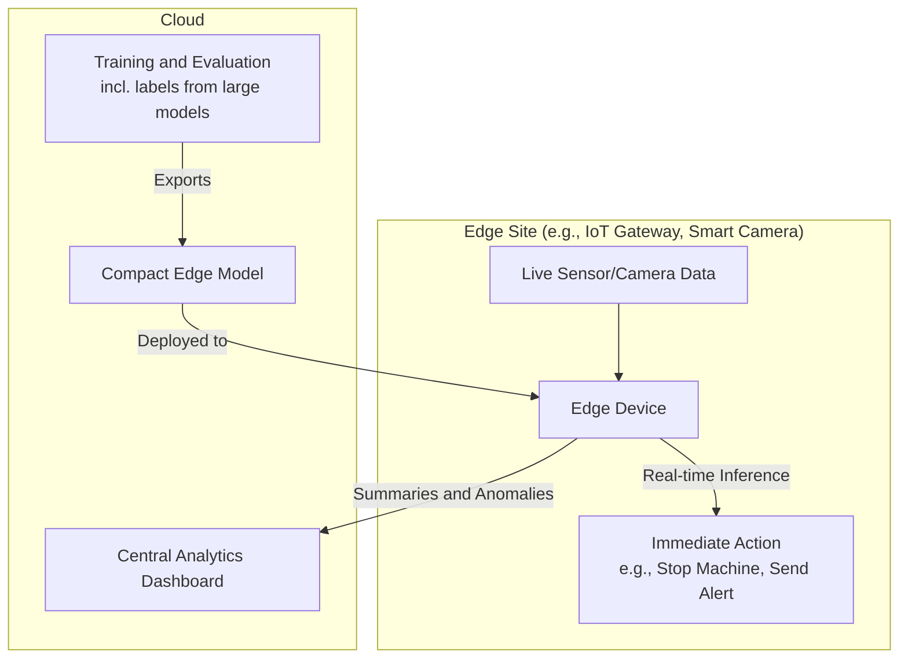
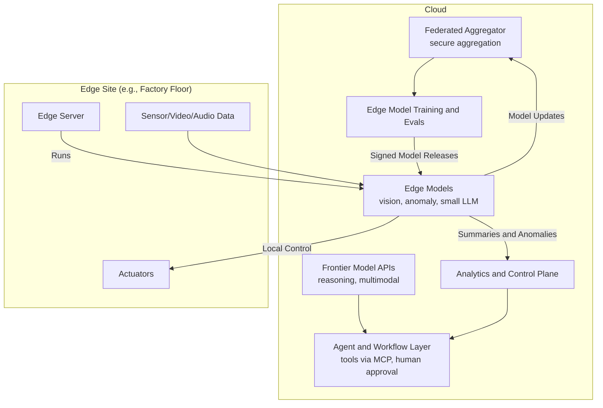

# Chapter 29: Emerging Patterns and Future Trends

The world of AI moves at a breathtaking pace. Things that were research demos when the first edition of this book was written in mid-2025 (models that reason for minutes before answering, agents that write and test entire features, assistants that operate a computer) were production features a year later. As a developer, it's not enough to master the present; you need a clear view of where things are heading, and, just as importantly, the judgment to tell real trends from hype.

This chapter surveys the developments that are reshaping AI application development as of late 2026, separating what is already practical from what is still speculative.

### Learning Objectives

By the end of this chapter, you will be able to:

-   Explain how **reasoning models** and test-time compute change application design.
-   Describe the state of **agents**, including coding and computer-use agents, and the protocols connecting them.
-   Use **multimodal and real-time** capabilities across text, images, audio, video, and documents.
-   Evaluate **open-weight, small, and on-device models**, and design **edge AI** architectures.
-   Understand **federated learning** and its privacy limits.
-   Put **quantum computing** claims in realistic perspective.

## Trend 1: Reasoning Models and Test-Time Compute

The most consequential shift of 2025–2026 was the move to **reasoning models**: models that generate an internal chain of thought before answering, and whose accuracy on hard problems improves the more "thinking" they are allowed to do. Capability now scales not only with model size and training, but with **compute spent at inference time**.

What this means for you as an engineer:

-   **A new dial.** Reasoning effort (or thinking level) trades quality against latency and cost per request. Choosing it per task, low for routing and extraction, high for planning and code, is now part of system design (Chapters 5 and 21).
-   **Simpler prompts.** Many prompting tricks that compensated for single-pass models (Chapters 9 and 10) are less necessary; clear goals, context, and constraints matter more than step-by-step instructions.
-   **Different failure modes.** Reasoning models are better at multi-step problems but can be slow, expensive on runaway problems, and still confidently wrong. Evaluation (Chapter 24) remains the only reliable judge.

## Trend 2: Agents Move into Production

Agents (Part 4) went from fragile demos to everyday tools, led by **coding agents** that read a codebase, make changes across many files, run the tests, and iterate until they pass. Several patterns have emerged:

-   **Long-horizon tasks:** Agents now work for many minutes or hours on a single task, which requires durable state, budgets, checkpoints, and context-management techniques (summarizing or clearing old context) to stay within limits.
-   **Computer use:** Models can operate graphical interfaces (seeing the screen, moving the mouse, typing), which lets them automate legacy software that has no API, at the cost of speed and new security risks.
-   **Managed agent platforms:** Providers now offer hosted agents that run the loop and a sandboxed workspace for you, alongside agent SDKs for running your own.
-   **Open protocols:** The **Model Context Protocol (MCP)** (Chapter 14) has become the standard way to connect agents to tools and data, and the **Agent2Agent (A2A)** protocol addresses communication between agents built by different teams and vendors.

The engineering lessons of this book apply with extra force: least privilege, human approval for consequential actions, defences against indirect prompt injection (Chapter 22), and evaluation on realistic tasks before deployment.

## Trend 3: Multimodal and Real-Time by Default

Multimodality is no longer a frontier feature. The flagship models from all major providers accept text, images, and PDFs, and several handle audio and long video natively. On the output side, image generation and editing, speech generation, and video generation are available through APIs. Two practical consequences:

-   **Documents as images.** Instead of extracting text from PDFs (and losing tables, charts, and layout), you can increasingly give the model the document itself.
-   **Real-time voice.** Speech-to-speech APIs allow natural, interruptible voice conversations with low latency, which opens up voice agents for field technicians, call centers, and hands-free industrial settings.

### A Practical Example: Multimodal Industrial Diagnosis

Imagine diagnosing a machine fault from a video of the machine, an audio recording of its noise, the live sensor log, and the PDF manual, all in one request. With the Gemini SDK from Chapter 7:

```python
import time
from google import genai
from google.genai import types

client = genai.Client()

def upload_and_wait(path: str) -> types.File:
    uploaded = client.files.upload(file=path)
    while uploaded.state == types.FileState.PROCESSING:
        time.sleep(5)
        uploaded = client.files.get(name=uploaded.name)
    if uploaded.state == types.FileState.FAILED:
        raise RuntimeError(f"Processing failed for {path}")
    return uploaded

def diagnose_machine_failure(video_path: str, audio_path: str, sensor_logs: str, manual_path: str) -> str:
    """Asks one multimodal model to reason across video, audio, logs, and a manual."""
    files = [upload_and_wait(p) for p in (manual_path, video_path, audio_path)]
    prompt = f"""
You are an industrial maintenance engineer. Diagnose the likely failure of Machine-007 using ALL sources:
the attached manual (PDF), the video and audio recorded during the fault, and these sensor logs:

<sensor_logs>
{sensor_logs}
</sensor_logs>

Give the most likely root cause, cite specific evidence from each source (video timestamps as MM:SS,
sounds you hear, log lines, manual sections), and a prioritized action plan.
"""
    response = client.models.generate_content(model="gemini-4-argon", contents=[*files, prompt])
    return response.text

# print(diagnose_machine_failure("machine_fault.mp4", "machine_noise.mp3",
#       "14:30:15 motor_current=5.2A | 14:30:16 vibration=3.5g | 14:30:17 temp=95C", "machine_manual.pdf"))
```

Multimodal reasoning is powerful for diagnosis and inspection, but treat its observations as hypotheses: models can misread gauges, miss subtle sounds, or attribute timestamps imprecisely. Use it to direct a technician's attention, not to replace their inspection.

## Trend 4: Open-Weight, Small, and On-Device Models

Not every application needs a frontier model in the cloud. Capable **open-weight** models (families such as Llama, Qwen, Gemma, Mistral, DeepSeek, and OpenAI's gpt-oss) can be downloaded, fine-tuned (Chapter 26), and run on your own infrastructure, and **small models** in the 1–10 billion parameter range now handle many focused tasks well. Phones and laptops increasingly include on-device models and neural processing units (NPUs).

Reasons to run models yourself include data control (nothing leaves your network), predictable cost at high volume, offline operation, and low latency. The costs are operational: you own the GPUs or devices, the serving stack (for example vLLM or llama.cpp), monitoring, and upgrades, and the best open models still trail the frontier on the hardest tasks. A common pattern is hybrid: a small local model for routine, private, or latency-critical work, with escalation to a frontier API for hard cases.

## Trend 5: Edge AI

**Edge AI** runs models directly on or near the device: a camera, an IoT gateway, a factory server. For IoT, it addresses three problems with cloud-only processing:

1.  **Latency:** a round trip to the cloud is too slow for real-time control (stopping a conveyor when a defect appears).
2.  **Bandwidth and cost:** streaming continuous video or high-frequency sensor data to the cloud is expensive.
3.  **Privacy and resilience:** sensitive data stays on site, and the system keeps working when the network doesn't.

Most edge AI today is not LLMs but compact, specialized models (defect classifiers, anomaly detectors, keyword spotters), exported to portable formats and run with runtimes such as ONNX Runtime, LiteRT (formerly TensorFlow Lite), OpenVINO, or vendor SDKs for hardware like NVIDIA Jetson. Small language models are increasingly practical on gateways and edge servers too.



Here is the shape of an edge inspection loop using ONNX Runtime with an exported defect-detection model:

```python
import time

import numpy as np
import onnxruntime as ort     # pip install onnxruntime

class EdgeDefectDetector:
    def __init__(self, model_path: str = "/models/defect_detector_v2.onnx", threshold: float = 0.9):
        self.session = ort.InferenceSession(model_path)        # runs locally; no network needed
        self.input_name = self.session.get_inputs()[0].name
        self.threshold = threshold

    def defect_probability(self, frame: np.ndarray) -> float:
        """frame: a preprocessed image tensor shaped as the model expects, e.g. (1, 3, 224, 224) float32."""
        (scores,) = self.session.run(None, {self.input_name: frame})
        return float(scores[0][1])                             # assumes outputs [p_ok, p_defect]

def inspection_loop(detector, get_frame, stop_line, send_to_cloud, heartbeat_seconds: int = 60):
    frames_since_heartbeat, last_heartbeat = 0, time.monotonic()
    while True:
        p = detector.defect_probability(get_frame())
        frames_since_heartbeat += 1
        if p >= detector.threshold:
            stop_line()                                        # immediate, local action
            send_to_cloud({"event": "defect", "probability": p})
        if time.monotonic() - last_heartbeat >= heartbeat_seconds:
            send_to_cloud({"event": "heartbeat", "frames": frames_since_heartbeat})
            frames_since_heartbeat, last_heartbeat = 0, time.monotonic()
```

The cloud's role becomes training, evaluating, and distributing models, plus fleet-wide analytics. Note that large models can help *build* edge models, for example by labeling training images, even when they can't run on the device.

## Trend 6: Federated Learning and Privacy

Many organizations cannot centralize sensitive data for training. **Federated learning** brings the model to the data instead:

1.  A central server sends the current model to many participants (phones, hospitals, factories).
2.  Each participant trains on its own data, which never leaves its site.
3.  Participants send back only model **updates** (weight changes).
4.  The server aggregates the updates into an improved shared model, and the cycle repeats.

An important caveat: model updates are *not* automatically anonymous. Research has shown that individual training examples can sometimes be reconstructed from raw updates. Production systems therefore add **secure aggregation** (the server sees only the combined update, never an individual one) and often **differential privacy** (calibrated noise that bounds what can be learned about any individual). Federated learning is in real use, notably in mobile keyboards and in healthcare research consortia, but it adds significant complexity; use it when data genuinely cannot be pooled.

## Trend 7: Quantum Computing and AI, in Perspective

Quantum computing is often mentioned alongside AI, so it's worth being precise. Quantum computers use qubits, which can represent superpositions of states, and for certain problems (such as simulating quantum systems in chemistry and materials science, or factoring large numbers) quantum algorithms offer provable speedups.

For AI engineering, keep these points in mind:

-   **No practical impact on LLMs today.** There is no evidence that quantum computers will speed up training or running large neural networks in the foreseeable future; current machines are small and error-prone, and moving the enormous datasets of modern AI into a quantum computer is itself a fundamental bottleneck.
-   **The near-term relevance is security.** Large, error-corrected quantum computers would break widely used public-key cryptography. Standards bodies have already published **post-quantum cryptography** algorithms, and migrating to them is a real engineering task today, independent of AI.
-   **Possible long-term synergies** include quantum simulation for drug and materials discovery, where AI models and quantum methods could complement each other.

Treat claims of near-term "quantum AI" breakthroughs with skepticism, and don't design production systems around them.

## Designing a Next-Generation IoT Architecture

Let's combine the practical trends into a forward-looking architecture:



**Key features:**
1.  **Edge-first for real-time control:** safety shutdowns and quality checks run locally on compact models, with deterministic rules as the final safety layer.
2.  **Cloud reasoning for complex work:** frontier reasoning and multimodal models handle diagnosis, planning, and reporting, orchestrated as workflows and agents with tools exposed through MCP and human approval for consequential actions.
3.  **Federated improvement with privacy safeguards:** edge models improve from all sites without pooling raw data.
4.  **Disciplined releases:** edge models are evaluated, signed, and rolled out gradually, like any other deployment (Chapter 25).
5.  **Efficient data flow:** only summaries, anomalies, and model updates leave the site.

## Conclusion

The AI landscape keeps evolving, and your job is to build with today's tools while keeping your architecture ready for tomorrow's. The trends that matter most right now:

-   **Reasoning models** add a quality-versus-cost dial to every request.
-   **Agents** are in production, connected by open protocols like MCP and A2A, and demand rigorous security and evaluation.
-   **Multimodal and real-time** capabilities are standard.
-   **Open-weight, small, and edge models** bring AI closer to the data, with real operational costs.
-   **Federated learning** enables collaboration without pooling data, when combined with proper privacy safeguards.
-   **Quantum computing** is a security migration to plan for, not an AI accelerator to build on.

The specific models and products will keep changing. The engineering principles of this book (measure, constrain, secure, and keep humans in control where it matters) are what will keep your systems working as they do.

## Key Takeaways

-   Treat reasoning effort as a per-task setting chosen by measurement: low for routing and extraction, higher for planning and code, decided by quality, latency, and cost on your own evals rather than left at a default.
-   Production agents, including coding and computer-use agents, need durable state, budgets, least privilege, human approval for consequential actions, and defences against indirect prompt injection; MCP connects agents to tools and data, and A2A connects agents to each other.
-   Multimodal models can take the PDF, video, and audio directly (with `google-genai`, upload with `client.files.upload` and wait until the file leaves the `PROCESSING` state), but treat their observations as hypotheses that direct a technician, not as an inspection.
-   Self-hosting open-weight and small models buys data control, predictable cost at volume, offline operation, and low latency, at the price of owning the serving stack; a common design is a local model for routine work with escalation to a frontier API.
-   Edge AI for IoT mostly means compact, specialized models run with ONNX Runtime, LiteRT, or OpenVINO that act locally, with deterministic rules as the final safety layer, only summaries and anomalies sent to the cloud, and models evaluated, signed, and rolled out gradually.
-   Federated learning needs secure aggregation and often differential privacy, because raw updates can leak training examples; quantum computing is a post-quantum cryptography migration to plan for, not an AI accelerator to design around.

## Exercises

**1. Warm-up:** Take 20 cases from an eval set you built earlier (for example the IoT log classification test set from Chapter 26) and run each one with `reasoning={"effort": ...}` set to `"low"`, `"medium"`, and `"high"` on the Responses API. Record accuracy, median latency, and total output tokens from `response.usage` for each setting. Done means a three-row table and a chosen effort level for this task, justified in one sentence by the numbers.

**2. Build:** Make `inspection_loop` testable without a camera or GPU: add a `max_frames` parameter (or accept an iterator of frames) and inject a fake detector and fake callbacks that record their calls. Write tests that check: a frame at or above the threshold calls `stop_line` and sends a `defect` event; a heartbeat reports the right frame count; and when `send_to_cloud` raises a connection error, the loop still stops the line and keeps processing frames. Done means all tests pass, and the network-failure test fails against the original code, which shows why the local action must not depend on the cloud call succeeding.

**3. Stretch:** Build the hybrid local/cloud pattern for IoT log classification. Run a small open-weight model locally behind an OpenAI-compatible server (for example vLLM or llama.cpp's `llama-server`), and escalate a request to your frontier model whenever the local output is not exactly one of the allowed categories or the local server times out. Done means a table comparing local-only, cloud-only, and hybrid on the same test set for accuracy, share of requests escalated, median latency, and estimated cost per 1,000 requests, plus a recommendation for which one you would run.

# References and Further Reading

- [Learning to reason with LLMs (OpenAI, 2024)](https://openai.com/index/learning-to-reason-with-llms/)
- [Model Context Protocol](https://modelcontextprotocol.io)
- [ONNX Runtime documentation](https://onnxruntime.ai/docs/)
- [Communication-Efficient Learning of Deep Networks from Decentralized Data (McMahan et al., 2016)](https://arxiv.org/abs/1602.05629)
- [Deep Leakage from Gradients (Zhu et al., 2019)](https://arxiv.org/abs/1906.08797)
- [Post-Quantum Cryptography standardization (NIST)](https://csrc.nist.gov/projects/post-quantum-cryptography)
